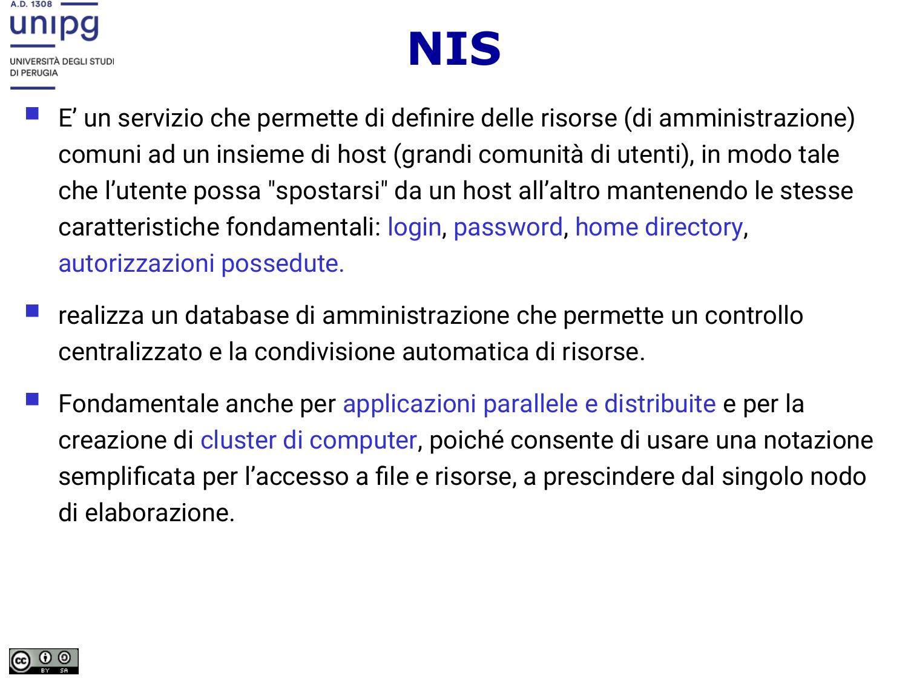
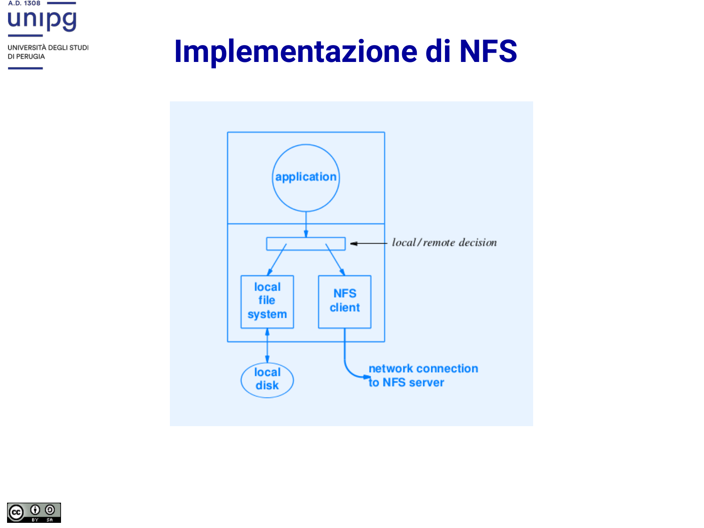
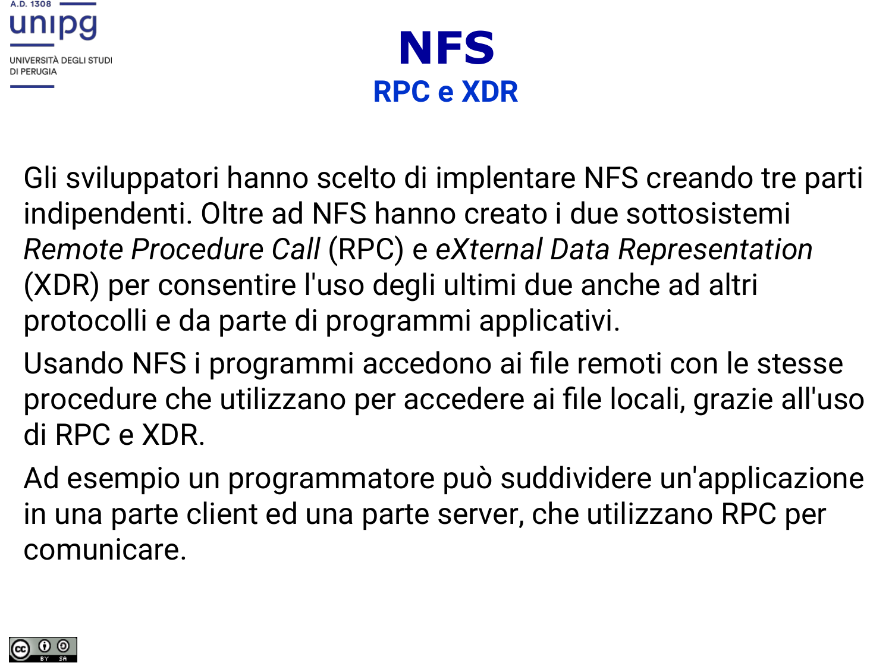

# Network Information Service (NIS) e Network File System (NFS)

## Network Information Service (NIS)

*Definizione:* servizio di directory distribuito sviluppato da Sun Microsystems (noto storicamente come *Yellow Pages*, `yp`) per definire e condividere risorse di amministrazione comuni a un insieme di host all'interno di una rete locale.

Consente a grandi comunità di utenti di spostarsi da un host all'altro della rete mantenendo inalterate le proprie impostazioni essenziali:

- credenziali di autenticazione (login e password);
- percorso e contenuti della home directory;
- identificativi numerici utente e gruppo (UID e GID);
- autorizzazioni di accesso e appartenenza ai gruppi.

NIS realizza un database di amministrazione che permette un controllo centralizzato e la condivisione automatica di risorse. È fondamentale anche per applicazioni parallele e distribuite e per la creazione di cluster di computer, poiché consente di usare una notazione semplificata per l'accesso a file e risorse, a prescindere dal singolo nodo di elaborazione su cui viene eseguito il processo.

L'utilizzo di NIS è completamente trasparente per l'utente finale.

### NIS Maps

NIS converte i principali file di configurazione ASCII di UNIX in database indicizzati basati sul formato DBM/Berkeley DB, denominati **NIS Maps**. L'amministratore modifica i file in un unico punto centrale sul server, e le mappe binarie generate consentono ricerche veloci per chiave (es. per nome utente o per identificativo numerico).

| File ASCII UNIX locale | Mappe NIS binarie generate | Funzione e contenuto |
|---|---|---|
| `/etc/passwd` | `passwd.byname`, `passwd.byaddr` | Login, hash password, UID, GID, shell e percorso home directory. |
| `/etc/group` | `group.byname`, `group.byaddr` | Definizione dei gruppi e relativi elenchi di utenti appartenenti. |
| `/etc/netgroup` | `netgroup.byname`, `netgroup.byaddr` | Autorizzazioni aggregate per gruppi di host e utenti per l'accesso a risorse (usato da NFS e `.rhosts`). |
| `/etc/auto.home` | Mappa automounter | Posizione di montaggio assoluta delle home directory degli utenti. |
| `/etc/ethers` | `ethers.byname`, `ethers.byaddr` | Associazione tra indirizzi Ethernet (MAC) e indirizzi IP (usato da RARP). |
| `/etc/hosts` | `hosts.byname`, `hosts.byaddr` | Mapping statico tra indirizzi IP e hostname locali. |
| `/etc/networks` | `networks.byname`, `network.byaddr` | Corrispondenza tra indirizzi di rete e nomi simbolici di sottorete. |
| `/etc/netmasks` | `netmasks.byaddr` | Tabella contenente indirizzo di rete e relativa subnet mask. |
| `/etc/protocols` | `protocols.byname`, `protocols.byaddr` | Elenco dei protocolli di rete supportati e relativi numeri identificativi IANA. |
| `/etc/services` | `services.byname` | Porte TCP/UDP standard e relativi nomi di servizio di rete. |
| `/etc/aliases` | `mail.byname`, `mail.byaddr` | Alias per l'instradamento locale della posta elettronica. |

### Architettura master, slave e client

- **NIS Domain:** raggruppamento logico di host che condividono lo stesso insieme di mappe amministrative. Il nome del dominio NIS viene impostato e verificato con il comando:

  ```bash
  domainname nomedominio
  ```

- **NIS Master Server:** unico host autoritativo in cui risiedono i file sorgente in chiaro. Le mappe binarie vengono memorizzate nella directory `/var/yp` e rigenerate tramite l'utility `make` a ogni modifica:

  ```bash
  cd /var/yp && make
  ```

  Il demone `ypserv` gestisce ed evade le richieste provenienti dai client e dagli slave.

- **NIS Slave Server:** macchine che mantengono una replica identica in sola lettura delle mappe NIS, aggiornate tramite il processo di sincronizzazione `ypxfr`. Forniscono ridondanza in caso di arresto del Master e ripartiscono il carico di interrogazione nelle reti di grandi dimensioni.

- **NIS Client:** nodi che interrogano i server NIS. Il demone client `ypbind` si mette in ascolto ed effettua il binding con il server NIS (master o slave) attivo per il dominio locale.

<div style="display: flex; justify-content: center;">
  
</div>

- **Integrazione sui file client:** nei client, all'interno dei file locali (es. `/etc/passwd`), viene inserito il marcatore speciale:

  ```text
  +::::::
  ```

  che indica al sistema di estendere la ricerca delle credenziali interrogando il demone `ypbind` qualora l'utente non sia definito localmente.

**Comandi di interrogazione:**

- `ypwhich`: visualizza il nome dell'host server NIS a cui il client è attualmente collegato.
- `ypcat nome_mappa`: stampa l'intero contenuto della mappa specificata (es. `ypcat passwd.byname`).
- `ypmatch chiave nome_mappa`: cerca una chiave specifica all'interno della mappa indicata.
- `yppasswd`: utility che permette all'utente finale di modificare la propria password direttamente sul server NIS Master.

### Servizi condivisi attraverso NIS

Le informazioni NIS sono generalmente memorizzate nella directory `/var/yp` e vanno ridistribuite ogni volta che viene effettuata una modifica al Master Server (la rigenerazione delle mappe NIS viene effettuata mediante l'utility makefile).

I servizi condivisi attraverso NIS sono:

- Autenticazione (login, passwd);
- Home directory;
- Accesso a stampanti, via `lpr`;
- NFS;
- Risorse di rete.

### Limiti di sicurezza

NIS trasmette i record e gli hash delle password in chiaro sulla rete locale e verifica l'accesso basandosi solo sul nome del dominio NIS (facilmente sniffabile o falsificabile). Per ambienti ad elevata sicurezza è stato superato da NIS+ e successivamente dallo standard LDAP affiancato da Kerberos.

## Network File System (NFS)

*Definizione:* protocollo per file system distribuito progettato da Sun Microsystems per consentire la condivisione trasparente di file e cartelle su rete IP. Gli utenti e i programmi applicativi manipolano i file residenti su un server remoto utilizzando le medesime chiamate di sistema (`open`, `read`, `write`, `close`) impiegate per il disco fisso locale.

### Vantaggi di NFS

- Riduzione dello spazio disco locale: una singola copia per directory, condivisa da tutta la rete.
- Semplificazione dei task di supporto: aggiornamento centralizzato dei file, ma accessibili da tutta la rete.
- Manipolazione dei file remoti con comandi UNIX locali (es. `cp`).

<div style="display: flex; justify-content: center;">
  
</div>

### Architettura: mounting e sharing

NFS si basa su due componenti fondamentali:

- **Lato client:** il client utilizza le directory remote come se fossero parte del filesystem locale. L'inserimento di una directory di un host remoto nel filesystem locale è detto **mounting** e viene realizzato mediante il comando `mount`.
- **Lato server:** il server mette a disposizione le proprie directory per l'uso da parte dei client. La condivisione di una directory locale ad host specifici per l'accesso remoto è detta **sharing** (il file system locale diventerà parte del filesystem remoto) e viene realizzata mediante il comando `export`.

### Architettura: RPC e XDR

NFS è implementato appoggiandosi a due sottosistemi indipendenti di supporto che nascondono la complessità del canale di comunicazione:

1. **Remote Procedure Call (RPC):** astrazione di programmazione distribuita. Consente a un programma client di invocare una procedura remota su un server come se fosse una funzione locale. Il meccanismo RPC si occupa di impacchettare i parametri (*marshaling*), spedire il messaggio sulla rete via TCP o UDP, attendere la risposta ed estrarre i valori di ritorno (*unmarshaling*).

   Programmando sul lato client delle procedure remote, viene incorporato il codice RPC in fase di compilazione, mentre sul lato server si implementano le funzioni volute e si incorporano le funzioni RPC per dichiararle parte del server. Quando il programma client esegue una delle procedure remote, RPC riunisce gli argomenti, forma il messaggio, lo invia al server remoto, aspetta una risposta e memorizza i valori restituiti negli argomenti opportuni. Il protocollo RPC nasconde tutti i dettagli dei protocolli, consentendo anche ai programmatori che non conoscono i protocolli di comunicazione sottostanti di scrivere programmi distribuiti.

2. **eXternal Data Representation (XDR):** protocollo di serializzazione dei dati che garantisce l'indipendenza dall'architettura hardware dei calcolatori. Converte i tipi di dato locali in una rappresentazione standard di rete (formato big-endian standard per interi a 32/64 bit, virgola mobile IEEE e stringhe con padding a 4 byte), consentendo la cooperazione tra macchine con diverso *endianness* (es. x86 little-endian e SPARC/PowerPC big-endian).

   XDR consente ai programmatori di scambiare dati tra macchine con architettura eterogenea, senza preoccuparsi della conversione tra le diverse rappresentazioni dei dati a livello hardware. Ai lati del canale di comunicazione i programmi usano le procedure XDR per convertire i dati dalla rappresentazione hardware locale ad una indipendente dall'architettura del computer. Una volta che i dati sono stati ricevuti, questi vengono convertiti dalla rappresentazione XDR indipendente a quella locale.

<div style="display: flex; justify-content: center;">
  
</div>

### Componenti e demoni del servizio

- **Lato Server:**
  - `nfsd [nservers]`: demone principale che riceve ed esegue le operazioni di I/O sui file inviate dai client; `nservers` definisce il pool di thread/processi concorrenti attivi. È presente solo nel server.
  - `rpc.mountd`: demone che intercetta ed elabora le richieste di montaggio (`mount`) provenienti dai client, verificando i diritti di accesso in `/etc/xtab`.
  - `exportfs`: utility usata per esportare le directory definite in `/etc/exports` aggiornando la tabella di stato attivo `/etc/xtab`.

- **Lato Client:**
  - `biod [nservers]`: *Block I/O Daemon*, gestisce le operazioni di lettura e scrittura asincrona, prefetch in cache e write-behind per massimizzare le prestazioni.

- **Condivisi (Server e Client):**
  - `rpc.lockd`: demone che implementa il protocollo NLM (*Network Lock Manager*) per gestire il blocco concorrente dei file (*file locking*).
  - `rpc.statd`: demone per il monitoraggio dello stato della rete e la segnalazione dei reboot (crash recovery).

### Configurazione del server: `/etc/exports`

Il server dichiara le directory locali da rendere disponibili ai client nel file `/etc/exports`.

Sintassi generale:

```text
directory [-opzione][,opzione]...
```

Opzioni di esportazione:

- `-ro`: accesso in sola lettura (*read-only*), impedisce qualsiasi modifica o creazione di file.
- `-rw [=host:host...]`: abilita lettura e scrittura; se accompagnato da nomi host, limita i permessi di scrittura ai soli nodi indicati.
- `-access=host:host...`: restringe l'accesso complessivo (sia in lettura che in scrittura) ai soli host o gruppi di rete (*netgroup*) specificati.
- `root=host`: concede i privilegi di `root` solo agli host elencati (`no_root_squash`), declassando per impostazione predefinita l'utente root remoto all'utente non privilegiato `nobody` (*root squashing* per motivi di sicurezza).

Esempio di file `/etc/exports`:

```text
/usr/public
/usr/man         -rw=mailhost:dnsserver
/usr/local       -ro
/u1              -access=netgrp1,root=mailhost:dnsserver,rw
/home/research   -access=mailhost:dnsserver:netgrp2
```

### Operazioni di montaggio sul client

- **Verifica delle esportazioni remote:**

  ```bash
  showmount -e nfsserver
  ```

  Interroga il demone `mountd` del server per visualizzare l'elenco delle cartelle esportate.

- **Montaggio manuale:**

  ```bash
  mkdir /home/ricerca
  mount nfsserver:/home/ricerca /home/ricerca
  ```

- **Smontaggio:**

  ```bash
  umount /home/ricerca
  ```

- **Montaggio automatico al boot (`/etc/fstab`):**

  Per ripristinare il collegamento NFS ad ogni riavvio della macchina client, si inserisce una riga dedicata in `/etc/fstab`:

  ```text
  nfsserver:/home/research  /home/research  nfs  rw  0  0
  ```
