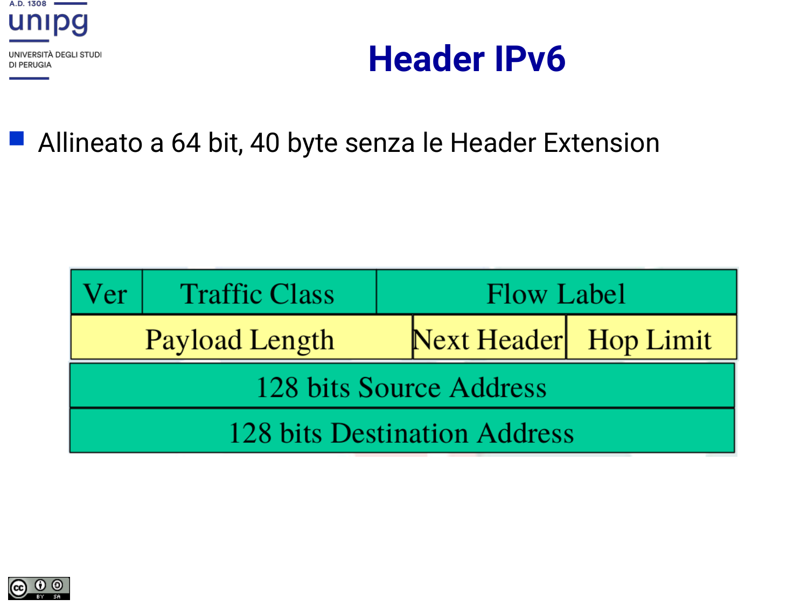
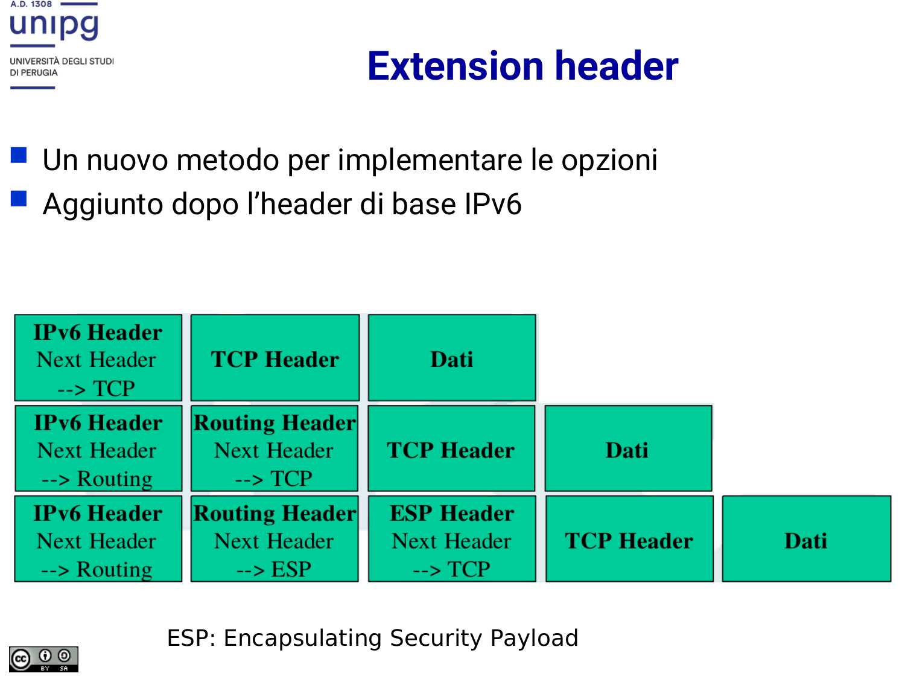
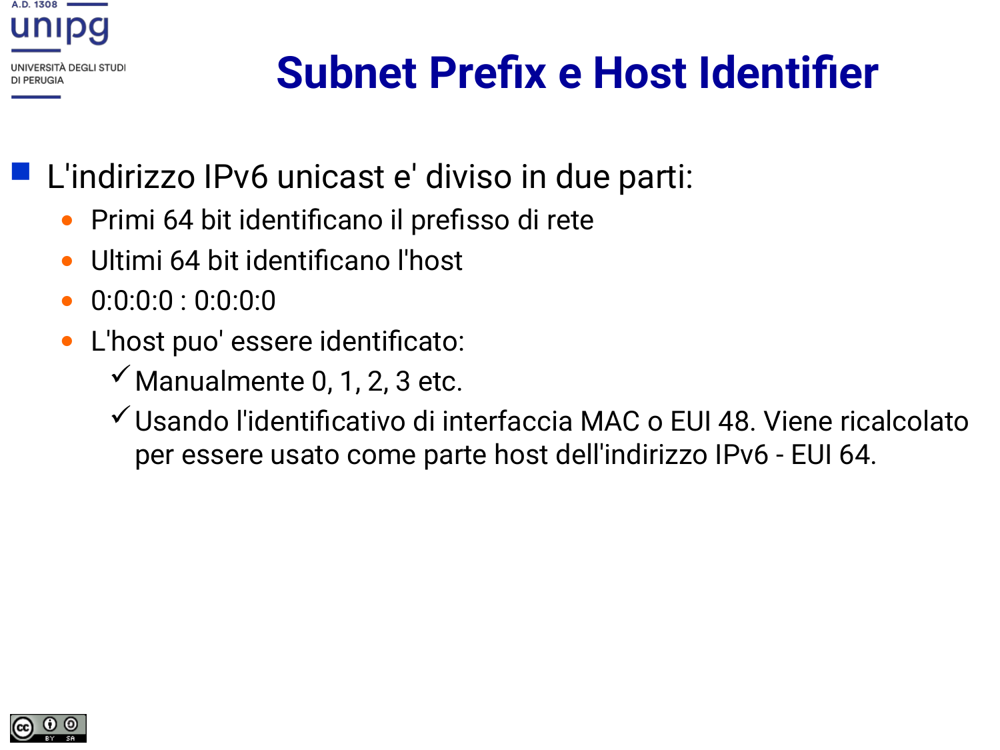
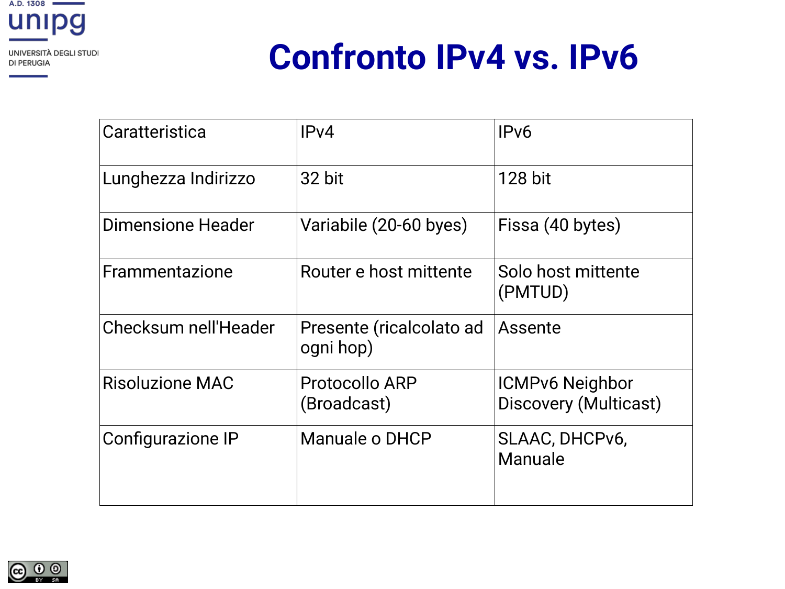

# IPv6

## Motivazioni e driver per un nuovo protocollo IP

*Definizione:* IPv6 (*Internet Protocol version 6*, standardizzato da RFC 2460 e aggiornato da RFC 8200) rappresenta l'evoluzione del protocollo IP progettata per superare i limiti strutturali di IPv4.

Le motivazioni storiche e architetturali che hanno guidato la nascita di IPv6 includono:

- **Esaurimento dello spazio di indirizzamento IPv4:** l'indirizzamento a 32 bit ($2^{32} \approx 4.3 \times 10^9$ indirizzi) è risultato insufficiente a fronte della crescita globale di Internet, degli apparati mobili e dell'Internet of Things.
- **Limiti architetturali del [[Lezione 11-SNMP e DHCP#Network Address Translation (NAT)|NAT]]:** l'uso massiccio del NAT ha introdotto pesante carico computazionale sui router, la violazione del principio *end-to-end* originale della rete, l'impossibilità di raggiungere direttamente nodi interni e forti complicazioni per protocolli server, peer-to-peer e comunicazioni cifrate punto-punto.
- **Spazio di indirizzamento a 128 bit:**
  - $2^{128} \approx 3.4 \times 10^{38}$ indirizzi teorici (circa $10^{30}$ indirizzi per ciascun abitante del pianeta).
  - Ripristino della vera connettività globale diretta: nessun host necessita di essere nascosto dietro NAT; ogni dispositivo possiede un indirizzo pubblico univoco e può agire sia da client che da server.
- **Efficienza di routing e prestazioni:**
  - Header base a dimensione fissa (40 byte esatti) per velocizzare l'elaborazione hardware nei router intermedi.
  - Rimozione del campo checksum di livello rete (demandato ai livelli trasporto [[Lezione 6-UDP e TCP e routing|TCP/UDP]] e link) per evitare il ricalcolo continuo a ogni hop.
  - Eliminazione della frammentazione nei router intermedi: i router scartano i pacchetti che eccedono la MTU e la frammentazione viene delegata esclusivamente all'host mittente.
- **Funzionalità native integrate:**
  - Autoconfigurazione plug-and-play (*Stateless Address Autoconfiguration*, SLAAC).
  - Semplificazione del *Multihoming* (connessione a più provider) e facilità nel cambio del prefisso di rete (*Renumbering*).
  - Eliminazione definitiva del broadcast a favore del traffico **Multicast**.
  - Supporto nativo integrato alla qualità del servizio (QoS) e alla sicurezza tramite la suite **IPsec**.

## Header IPv6 ed extension header

### Confronto header IPv4 e IPv6

L'intestazione IPv6 è stata ripulita da tutti i campi variabili e opzionali di IPv4:

- Dimensione fissa a **40 byte**, allineata a 64 bit.
- Spariscono rispetto a IPv4: *IHL* (lunghezza variabile dell'header), *Identification*, *Flags*, *Fragment Offset*, *Header Checksum* e le opzioni variabili di coda.

<div style="display: flex; justify-content: center;">
  
</div>

### Campi dell'header base IPv6

1. **Version (4 bit):** valore costante binario `0110` (decimale `6`).
2. **Traffic Class (8 bit):** specifica la priorità o classe di servizio del pacchetto per il supporto a QoS e meccanismi DiffServ (analogo al campo Type of Service di IPv4).
3. **Flow Label (20 bit):** identifica flussi contigui di pacchetti che richiedono un trattamento coerente da parte dei router lungo il cammino (es. traffico real-time audio/video).
4. **Payload Length (16 bit unsigned):** dimensione in byte dei dati trasportati al seguito dell'header base di 40 byte, includendo eventuali Extension Headers. Può indicare fino a 65.535 byte (o valori superiori con l'opzione Jumbogram).
5. **Next Header (8 bit):** specifica il tipo di intestazione immediatamente successiva. Può puntare a un'intestazione di estensione IPv6 o direttamente al protocollo di livello superiore ([[Lezione 6-UDP e TCP e routing|TCP]] = 6, [[Lezione 6-UDP e TCP e routing|UDP]] = 17, ICMPv6 = 58).
6. **Hop Limit (8 bit unsigned):** contatore decrementato di 1 da ciascun router che inoltra il pacchetto. Se raggiunge lo zero il pacchetto viene scartato e viene generato un messaggio ICMPv6 *Time Exceeded* (sostituisce il TTL di IPv4).
7. **Source Address (16 byte / 128 bit):** indirizzo IPv6 del nodo mittente.
8. **Destination Address (16 byte / 128 bit):** indirizzo IPv6 del nodo destinatario finale (o dell'eventuale router intermedio in caso di Routing Header).

<div style="display: flex; justify-content: center;">
  
</div>

### Extension Headers

Le opzioni in IPv6 non appesantiscono l'header principale: vengono inserite tra l'header base e il payload di trasporto concatenandole a lista collegata tramite il puntatore *Next Header*:

| Valore Next Header | Nome Extension Header | Funzione e nodi coinvolti nell'analisi |
|---|---|---|
| `00` | *Hop-by-Hop Options* | Informazioni che devono essere obbligatoriamente esaminate da ogni router intermedio lungo il tragitto (usato per Router Alert e Jumbogram). |
| `43` | *Routing* | Elenco di router obbligatori da attraversare lungo il percorso (analogo al Loose Source Routing di IPv4; impiegato in Mobile IPv6). |
| `44` | *Fragment* | Utilizzato unicamente dall'host mittente per suddividere datagrammi che eccedono la Path MTU e ricomposti solo dall'host destinatario. |
| `51` | *Authentication Header (AH)* | Autenticazione dell'origine del pacchetto e verifica dell'integrità dei dati contro manomissioni. |
| `50` | *Encapsulating Security Payload (ESP)* | Cifratura del carico utile per garantire la riservatezza e confidenzialità dei dati. |
| `60` | *Destination Options* | Informazioni aggiuntive destinate all'elaborazione esclusiva dell'host di destinazione (o del router designato in presenza di Routing Header). |
| `58` | *ICMPv6* | Protocollo di messaggistica di controllo e diagnosi per IPv6. |
| `59` | *No Next Header* | Indica che non vi è alcun carico o protocollo successivo nel pacchetto. |

*Ordine raccomandato degli header nel pacchetto:*
IPv6 Header $\rightarrow$ Hop-by-Hop Options $\rightarrow$ Destination Options (se Routing presente) $\rightarrow$ Routing $\rightarrow$ Fragment $\rightarrow$ Authentication Header (AH) $\rightarrow$ Encapsulating Security Payload (ESP) $\rightarrow$ Destination Options $\rightarrow$ Header di Livello Superiore (TCP/UDP).

## Notazione e sintassi degli indirizzi IPv6

Un indirizzo IPv6 è composto da 128 bit, rappresentati come 8 gruppi di 4 cifre esadecimali (ciascun gruppo vale 16 bit) separati dal carattere due punti (`:`):

```text
2001:0000:1234:0000:0000:00D0:ABCD:0532
```

Regole di compressione e formattazione:

1. **Case-insensitive:** l'uso di lettere maiuscole o minuscole è equivalente (`abcd` equivale ad `ABCD`).
2. **Omissione degli zeri a sinistra:** all'interno di ciascun gruppo da 16 bit gli zeri iniziali possono essere omessi:

   ```text
   2001:0:1234:0:0:D0:ABCD:532
   ```

3. **Compressione con doppio due punti (`::`):** una singola sequenza contigua di uno o più gruppi costituiti interamente da zeri può essere abbreviata con `::`:

   ```text
   2001:0:1234::D0:ABCD:532
   ```

   > [!warning] Attenzione:
   > Il simbolo `::` può comparire **al massimo una volta** all'interno di un indirizzo IPv6. Usarlo due volte renderebbe ambigua la determinazione del numero esatto di zeri omessi nei due blocchi. Non è valida ad esempio la notazione: `2001::1234::C1C0:ABCD:876`.

Esempi di compressione notevoli:

- `FF02:0:0:0:0:0:0:1` $\rightarrow$ `FF02::1`
- `0:0:0:0:0:0:0:1` $\rightarrow$ `::1`
- `0:0:0:0:0:0:0:0` $\rightarrow$ `::`

### Indirizzi IPv6 nelle URL

Poiché il carattere `:` è già utilizzato nelle URL per separare l'indirizzo host dal numero di porta di servizio, gli indirizzi IPv6 letterali inseriti nelle URL devono essere obbligatoriamente racchiusi tra parentesi quadre:

```text
http://[2001:1:4F3A::206:AE14]:8888/index.html
```

## Classificazione degli indirizzi IPv6

L'architettura divide l'indirizzo Unicast globale in due porzioni canoniche da 64 bit ciascuna:

- **Subnet Prefix (primi 64 bit):** identifica la rete e la specifica sottorete.
- **Interface Identifier / Host ID (ultimi 64 bit):** identifica in modo univoco la specifica interfaccia di rete dell'host.

<div style="display: flex; justify-content: center;">
  
</div>

L'Interface Identifier può essere assegnato manualmente oppure autogenerato a partire dal MAC address a 48 bit dell'interfaccia di rete tramite il formato **EUI-64**:

- Si divide l'indirizzo MAC di 6 byte a metà (3 byte di OUI e 3 byte di vendor ID).
- Si inseriscono al centro i 2 byte fissi `0xFFFE`.
- Si inverte il settimo bit del primo byte (bit *Universal/Local*, portandolo a 1 se l'indirizzo MAC è globalmente univoco).

### Tipologie di indirizzi Unicast

- **Unspecified Address (`::/128`, o `0:0:0:0:0:0:0:0`):** formato da soli zeri (analogo a `0.0.0.0` in IPv4). Indica l'assenza formale di un indirizzo IP; impiegato come IP sorgente temporaneo nella richiesta iniziale DHCP o durante la verifica di unicità dell'indirizzo (*Duplicate Address Detection*, DAD). La notazione `::/0` indica la rotta predefinita (*default route*).
- **Loopback Address (`::1/128`):** formato da 127 bit a zero e l'ultimo bit a 1. Identifica la macchina locale (analogo a `127.0.0.1` in IPv4). Si verifica la corretta funzionalità dello stack locale tramite:

  ```bash
  ping6 ::1
  ```

- **Link-Local Unicast (`fe80::/10`):**
  - Indirizzo con validità limitata (*scoped address*) al solo segmento fisico locale (link o VLAN).
  - Viene autoconfigurato automaticamente dal sistema operativo su qualsiasi interfaccia attiva all'avvio combinando il prefisso `FE80::/64` con l'Interface Identifier.
  - Non può essere instradato dai router verso altri segmenti.
  - Fornisce la connettività di base immediata per il Neighbor Discovery, lo scambio di parametri di routing e la configurazione iniziale.
- **Site-Local Unicast (`fec0::/10` - deprecato da RFC 3879 a favore di *Unique Local Addresses* `fc00::/7`):**
  - Scope limitato alla rete aziendale o al campus. Formato da prefisso, 16 bit di Subnet ID (permettendo 65.536 sottoreti) e 64 bit di Interface ID.
  - Non instradabile su Internet pubblica, ideato originariamente come analogo degli indirizzi privati IPv4 per stampanti o nodi interni.
- **Aggregatable Global Unicast (`2000::/3`):**
  - Indirizzi pubblici routabili globalmente sull'intera rete Internet.
  - Best practice di allocazione gerarchica:
    - `/23`: blocchi assegnati ai Regional Internet Registries (RIRs, come RIPE NCC).
    - `/35`: blocchi allocati ai Local Internet Registries (LIRs / Internet Service Provider).
    - `/48`: prefisso standard consegnato alle organizzazioni e aziende clienti finali.
    - `/64`: prefisso di ogni singola sottorete interna del cliente (lasciando sempre 64 bit per gli host).

### Indirizzi Multicast (`ff00::/8`)

In IPv6 il concetto di trasmissione broadcast non esiste: ogni operazione prima svolta in broadcast (come la risoluzione ARP) viene eseguita tramite traffico Multicast mirato.

Formato: `FF<flags><scope>::<group>`

- *Flags (4 bit):* `0` indica un indirizzo permanente assegnato da IANA; `1` indica un indirizzo temporaneo/dinamico.
- *Scope (4 bit):* definisce l'ambito di propagazione del pacchetto (`1` = Interface-local, `2` = Link-local, `5` = Site-local, `8` = Organization-local, `E` = Global). Sostituisce la funzione del TTL per delimitare il raggio d'azione del traffico.

**Indirizzi multicast riservati fondamentali:**

| Indirizzo | Scope | Destinatari |
|---|---|---|
| `FF01::1` | Interface-local | Tutti i nodi dell'interfaccia locale. |
| `FF02::1` | Link-local | Tutti i nodi presenti sul segmento fisico locale (*All Nodes*). |
| `FF01::2` | Interface-local | Tutti i router collegati all'interfaccia. |
| `FF02::2` | Link-local | Tutti i router presenti sul link locale (*All Routers*). |
| `FF05::2` | Site-local | Tutti i router del sito aziendale. |
| `FF02::1:FFxx:xxxx` | Link-local | *Solicited-Node Multicast Address*: associato a ogni indirizzo unicast per la risoluzione degli indirizzi di livello 2 (sostituisce ARP). |

### Indirizzi Anycast

Indirizzo sintatticamente identico a un indirizzo Unicast globale, ma assegnato contemporaneamente alle interfacce di più nodi distinti della rete:

- Il protocollo di routing instradatore recapita il pacchetto all'interfaccia geograficamente e topologicamente più vicina (*one-to-nearest*).
- Impiegato per individuare router di sottorete e per distribuire il carico di servizi infrastrutturali critici (come i Root Name Servers del [[Lezione 9-DNS|DNS]]).

### Indirizzi riconosciuti da un host e regole di selezione

Ogni host IPv6 mantiene attivi contemporaneamente molteplici indirizzi sulla medesima scheda di rete:

1. L'indirizzo Link-Local per ciascuna interfaccia attiva.
2. Uno o più indirizzi Global Unicast assegnati staticamente o tramite autoconfigurazione.
3. L'indirizzo di Loopback `::1`.
4. L'indirizzo multicast *All-Nodes* `FF02::1`.
5. Il *Solicited-Node multicast address* per ciascun indirizzo unicast configurato.
6. Gli indirizzi multicast degli specifici gruppi a cui l'host è iscritto.

*Regole di selezione dell'indirizzo sorgente e destinazione:* il kernel valuta la corrispondenza dell'ambito (se la destinazione è Link-Local, usa la sorgente Link-Local; se è Globale, usa la sorgente Globale) e seleziona l'indirizzo con la maggiore sovrapposizione di prefisso rispetto alla destinazione.

## Path MTU Discovery (PMTUD)

In IPv6 i router intermedi lungo la tratta non effettuano la frammentazione:

- Qualsiasi link di rete che supporti IPv6 deve garantire una **MTU minima di 1280 byte**.
- L'host mittente assume inizialmente come MTU di trasmissione la MTU della propria interfaccia locale.
- Se un router intermedio riceve un datagramma di dimensione superiore alla MTU del link di uscita, scarta il pacchetto e trasmette al mittente un messaggio ICMPv6 di errore **`Packet Too Big` (Type 2)** indicando nell'header il valore esatto della propria MTU.
- L'host sorgente memorizza il valore nella propria tabella di routing e riduce la dimensione dei pacchetti successivi.
- Il processo si ripete fino a individuare la minima MTU dell'intero cammino (*Path MTU*).
- Se l'applicazione deve trasmettere un blocco dati superiore alla Path MTU, è l'host sorgente a suddividerlo inserendo l'Extension Header di tipo *Fragment* (Next Header 44).

## Stateless Address Autoconfiguration (SLAAC)

Meccanismo di configurazione automatica "plug-and-play" senza necessità di server di gestione dedicati:

1. L'host genera il proprio indirizzo Link-Local (`FE80::` + EUI-64 o privacy extensions).
2. Esegue la procedura **Duplicate Address Detection (DAD)**: invia un messaggio *Neighbor Solicitation* (ICMPv6) al Solicited-Node multicast dell'indirizzo appena generato con IP sorgente `::`. Se nessun nodo risponde con un *Neighbor Advertisement*, l'indirizzo è dichiarato univoco e diventa operativo.
3. L'host trasmette un messaggio multicast **`Router Solicitation` (RS)** all'indirizzo `FF02::2` (tutti i router).
4. I router della rete rispondono con un **`Router Advertisement` (RA)** periodico o istantaneo, contenente il prefisso di rete globale `/64` e i parametri del link.
5. L'host concatena il prefisso `/64` ricevuto dal router con il proprio Interface ID a 64 bit, ottenendo un indirizzo Global Unicast valido per navigare su Internet in totale trasparenza.
6. Se la rete richiede parametri addizionali (es. server DNS specifici o assegnazioni centralizzate), l'host può affiancare a SLAAC il protocollo DHCPv6 stateful o stateless.

## IPsec nativo in IPv6

IPv6 integra nativamente il supporto all'architettura di sicurezza IPsec a livello di rete:

- Autenticazione dei peer a livello di rete, autenticazione dell'origine dei dati, integrità, cifratura e protezione contro gli attacchi di replay.
- Meccanismi realizzati tramite gli Extension Headers dedicati: **Authentication Header (AH, 51)** ed **Encapsulating Security Payload (ESP, 50)**.

Modalità operative:

- **Transport Mode (Host-to-Host):** solo il payload di livello superiore (TCP/UDP e dati) viene cifrato o autenticato; l'header IPv6 rimane invariato, consentendo il routing ordinario sui nodi pubblici intermedi.
- **Tunnel Mode (Network-to-Network / VPN):** l'intero pacchetto IPv6 originale (inclusa la sua intestazione) viene cifrato e incapsulato all'interno di un nuovo pacchetto IPv6 con un nuovo header esterno. Utilizzato per realizzare Virtual Private Network (VPN) tra router di confine, accessi remoti e collegamenti sicuri.

<div style="display: flex; justify-content: center;">
  
</div>

## Meccanismi di transizione e coesistenza con IPv4

Poiché la transizione globale da IPv4 a IPv6 non può avvenire con un passaggio istantaneo (*flag day*), sono adottati tre approcci di coesistenza:

- **Dual Stack:** approccio standard corrente in cui router e host eseguono contemporaneamente entrambi gli stack di protocollo (IPv4 e IPv6) sulle medesime interfacce fisiche.
- **Tunneling:** incapsulamento dei pacchetti IPv6 all'interno di normali datagrammi IPv4 per consentire il transito attraverso porzioni di infrastruttura legacy non ancora abilitate a IPv6.
- **Traduzione (NAT64 / DNS64):** permette a reti composte esclusivamente da host IPv6 (es. moderne reti radiomobili) di comunicare direttamente con server rimasti solo IPv4:
  - *NAT64:* funge da gateway di traduzione a livello di rete e trasporto, mappando lo spazio di indirizzi IPv4 a 32 bit all'interno di un intervallo di prefisso IPv6 dedicato.
  - *DNS64:* server DNS che intercetta le richieste di record `AAAA` e, se sono presenti unicamente record `A` IPv4 per quel dominio, sintetizza al volo un indirizzo `AAAA` instradabile verso il gateway NAT64.

## Proposta sperimentale IPv8 (draft-thain-ipv8-00)

*Definizione:* Internet-Draft individuale (aprile 2026, J. Thain, One Limited) che propone una suite di rete unificata e gestita, alternativa sia a IPv4 che alla transizione IPv6.

*Caratteristiche architetturali della proposta:*

- **Indirizzamento a 64 bit (`r.r.r.r` + `h.h.h.h`):** suddivisione dell'indirizzo in 32 bit di *Routing Prefix* (codificato dall'Autonomous System Number - ASN) e 32 bit di *Host Address*.
- **Piena retrocompatibilità al 100% con IPv4:** se il prefisso di routing vale `0.0.0.0`, l'indirizzo equivale a un indirizzo IPv4 standard, eliminando l'obbligo di riscrittura delle applicazioni legacy. Ciascun ASN riceve $2^{32}$ indirizzi host (circa 4,29 miliardi).
- **Prefissi di routing riservati:** `127.0.0.0/8` riservato per prefissi di zona interni (*Internal Zone Prefix*, non instradabili all'esterno); `100.0.0.0/8` riservato per peering regionale (RINE).
- **Zone Server integrato:** nodo di controllo ridondato (active/active) che centralizza:
  - *DHCP8:* rilascio contestuale dell'indirizzo e degli endpoint di DNS8, NTP8, logging e policy con un singolo scambio *Discover/Response*.
  - *OAuth8 (OAuth2/JWT):* autorizzazione di ogni apparato tramite token crittografici JWT validati localmente (< 1 ms).
  - *Update8:* aggiornamento controllato del software di rete dei primi 4 livelli ISO/OSI e blocco delle comunicazioni verso host non risolti tramite DNS8.
- **Sicurezza multilivello:**
  - *Isolamento Est-Ovest (traffico interno):* ACL8 a tre livelli (firmware NIC, gateway Zone Server e porte switch con VLAN gestite via OAuth2) per impedire il movimento laterale.
  - *Controllo Nord-Sud (traffico esterno):* verifica in uscita dell'esistenza di una recente risoluzione DNS8 (blocco di malware con IP hardcoded) e validazione del prefisso di destinazione sul database WHOIS8 contro attacchi di BGP hijacking.
- **Ottimizzazione del routing globale:**
  - Tabella BGP8 limitata strutturalmente a una singola voce per ASN (circa 175.000 voci contro le oltre 900.000 attuali di BGP4), con prefisso minimo `/16`.
  - Protocolli BGP8, OSPF8 e IS-IS8 basati su una metrica a 32 bit determinata da 7 parametri telemetrici: RTT, perdita pacchetti, finestra di congestione TCP, stabilità della sessione, capacità del link, policy economica e distanza geografica.

*Osservazione:* in quanto documento *draft-thain-ipv8-00*, si tratta di una bozza individuale sperimentale e non di uno standard adottato o ratificato dall'IETF.

## Confronto sinottico finale: IPv4 vs IPv6

| Caratteristica | IPv4 | IPv6 |
|---|---|---|
| **Lunghezza indirizzo** | 32 bit (circa 4,3 miliardi) | 128 bit (circa $3,4 \times 10^{38}$) |
| **Dimensione dell'header** | Variabile (da 20 a 60 byte con opzioni) | Fissa a 40 byte (estendibile tramite catena di Extension Headers) |
| **Frammentazione** | Eseguita dai router intermedi e dall'host mittente | Eseguita esclusivamente dall'host mittente tramite PMTUD |
| **Checksum nell'header** | Presente (ricalcolato da ogni router ad ogni hop) | Assente (eliminato per ottimizzare il throughput di routing) |
| **Risoluzione indirizzi MAC** | Protocollo [[Lezione 5-Internet Protocol, indirizzamento IPv4, subnetting e protocolli di supporto (ARP, ICMP, IGMP)|ARP]] basato su broadcast | Protocollo ICMPv6 Neighbor Discovery basato su Multicast |
| **Configurazione indirizzo IP** | Manuale o tramite [[Lezione 11-SNMP e DHCP#Protocollo DHCP|DHCP]] | SLAAC (Stateless plug-and-play), DHCPv6, oppure manuale |
| **Trasmissione Broadcast** | Presente nativamente | Totalmente assente; sostituito dal traffico Multicast scoped |
| **Supporto alla sicurezza** | Opzionale e aggiunto a posteriori (IPsec applicato su IPv4) | Integrato nativamente tramite Extension Headers AH ed ESP |
