# Serie di Fourier, filtri e modulazione

## Serie di Fourier

I segnali sinusoidali sono importanti perché sono molto semplici da trattare quando si studia un circuito. Il teorema di Fourier afferma che un segnale periodico qualsiasi può essere considerato come la somma di infinite sinusoidi con caratteristiche diverse. Matematicamente:

$$S(t) = A_0 + A_1 \sin(\omega t + \varphi_1) + A_2 \sin(2\omega t + \varphi_2) + A_3 \sin(3\omega t + \varphi_3) + \dots$$

Utilizzando un numero sempre maggiore di opportuni segnali sinusoidali, si ottiene in maniera sempre più precisa un'onda quadra.

**Approssimazione con 3ª armonica:**

  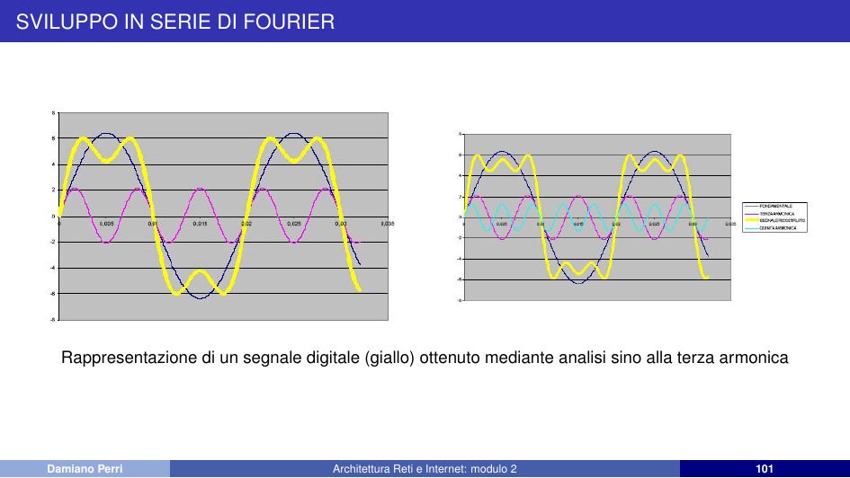

**Approssimazione con 5ª armonica:**

  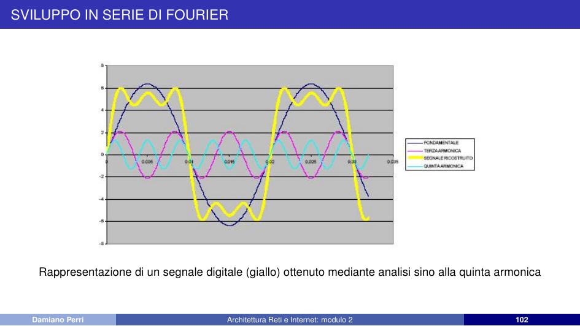

**Approssimazione con 9ª armonica:**

  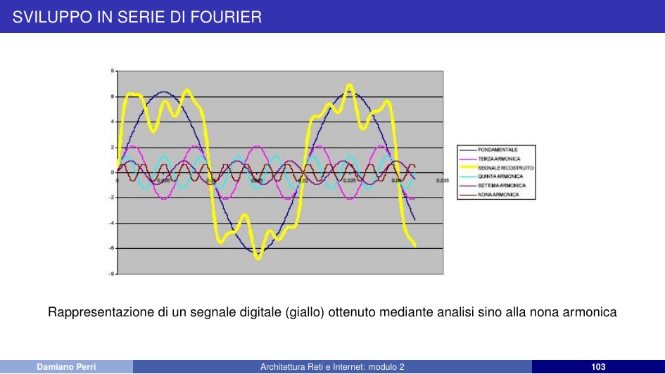

Nel caso in cui il segnale sia una pura sinusoide, quest'ultimo viene rappresentato nel dominio delle frequenze da un'unica armonica: utilizzando un numero maggiore di segnali sinusoidali possiamo ottenere una più accurata rappresentazione del segnale originale. Il numero di armoniche utilizzate varia a seconda della potenza del segnale da rappresentare: generalmente si tende a considerare l'armonica sino a che la sua ampiezza sia un decimo della componente fondamentale.

> [!note] Ricorda: differenza tra segnale analogico e digitale:
> - il **segnale analogico** è **continuo** nel tempo e può assumere **infiniti valori** all'interno di un intervallo, variando in modo fluido (spesso rappresentato da onde sinusoidali)
> - il **segnale digitale** è **discreto**, assumendo solo **valori specifici e limitati** (tipicamente **0 e 1** in codice binario) in istanti predeterminati (spesso rappresentato da onde quadre)

*Osservazione:* l'analisi di Fourier ricorda che un segnale digitale è un segnale analogico composto da banda teoricamente infinita. Il problema è come trasmettere una digitalizzazione del segnale analogico tra due punti. Le possibilità sono sostanzialmente due:
- Trasmissione del segnale di base (in banda base)
- Trasmissione con modulazione del segnale (in banda traslata)

## Filtri

Un filtro è un sistema che tratta in modo specifico le componenti di un segnale a frequenze diverse: generalmente blocca o lascia passare determinati range di frequenze, permettendo di separare informazioni condivise dallo stesso segnale; oppure di eliminare il disturbo (qualora avesse frequenze diverse da quelle del segnale portante). I filtri possono essere *attivi* o *passivi*, a seconda dei componenti presenti nel circuito che li costituisce: se presentano solo componenti passivi (resistori, condensatori) il filtro è passivo; con amplificatori operazionali e transistori è attivo.

Si distinguono quattro tipi di filtri:

### Filtro passa basso

Permette il passaggio di frequenze al di sotto di una determinata frequenza detta *frequenza di taglio*. Come frequenza di taglio viene presa quella in cui sussiste la relazione:

$$\frac{V_{out}}{V_{in}} = \frac{1}{\sqrt{2}} \approx 0,707$$

In uscita, il segnale è attenuato di circa il 30% in tensione (dimezzamento della potenza, −3 dB). È realizzabile con un circuito CR (resistore-condensatore) in serie.

  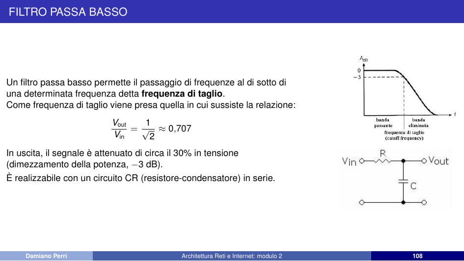

### Filtro passa alto

Permette il passaggio di frequenze al di sopra della frequenza di taglio. Realizzabile con un circuito CR (condensatore-resistore) in serie, fa passare tutte le componenti di frequenza comprese tra quella di taglio e la frequenza (in teoria) infinita. Sotto la frequenza di taglio, le componenti del segnale sono attenuate.

  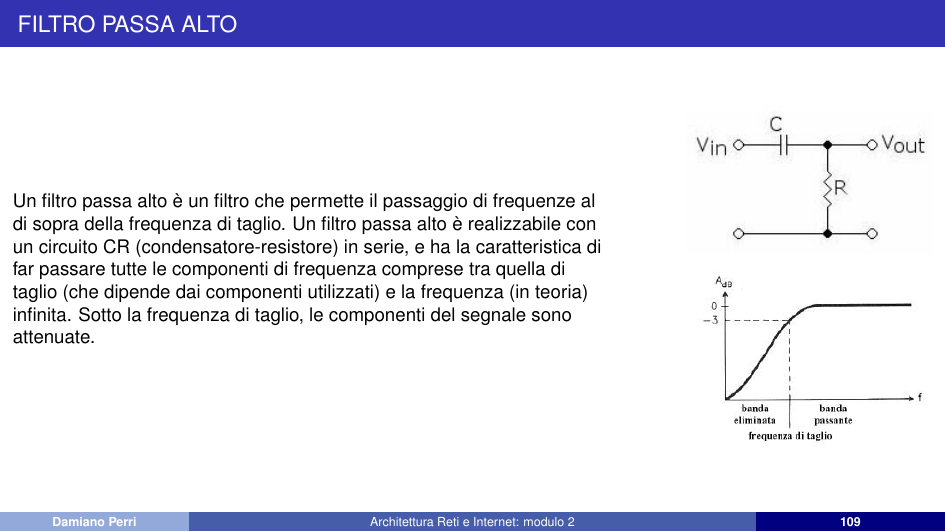

### Filtro passa banda

Fa passare le frequenze all'interno di un dato intervallo (detto *banda passante*) ed attenua le frequenze al di fuori di esso. I più semplici filtri passa banda possono essere realizzati da due filtri passa basso e passa alto opportunamente collegati.

  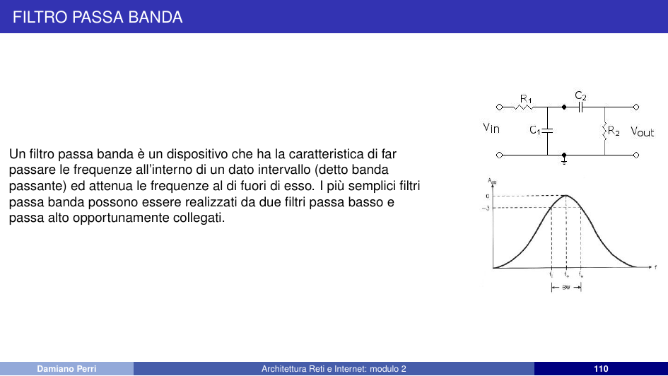

### Filtro elimina banda (notch)

Non permette il passaggio di frequenze in un dato intervallo. Il suo funzionamento è l'opposto di un filtro passa banda: elimina una banda di frequenze $[\omega_L, \omega_H]$.

  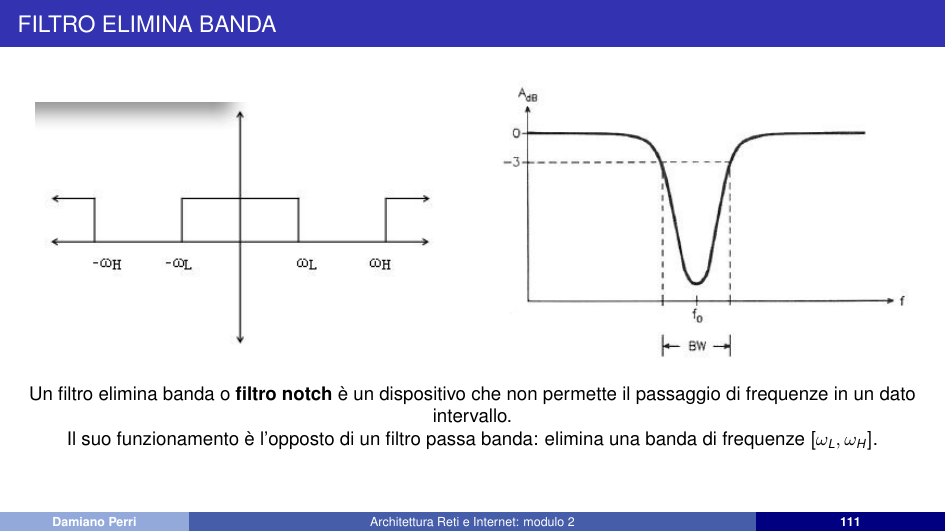

## Modulazione di un segnale

Il DTE sorgente immette nel canale trasmissivo un segnale digitale caratterizzato da una distribuzione di energia troppo ampia per poter essere contenuta in un canale telefonico: l'informazione sorgente deve essere convertita in una maniera idonea a essere inviata nella linea telefonica con una banda predefinita.

La *modulazione* è un'operazione reversibile, secondo la quale un segnale, definito *portante*, viene modificato in uno dei suoi parametri essenziali (frequenza, ampiezza o fase) in accordo al segnale informativo d'ingresso, chiamato *modulante*.

Si opera una prima classificazione tra:
- **Modulazione ad onda continua**
- **Modulazione impulsiva**

## Modulazione ad onda continua

La modulazione ad onda continua vede sostanzialmente tre tipi di modulazione analogica:
- **AM** (*Amplitude Modulation*) – modulazione di ampiezza
- **FM** (*Frequency Modulation*) – modulazione di frequenza
- **PM** (*Phase Modulation*) – modulazione di fase

### AM (Modulazione di ampiezza)

Sistema in cui si modula l'ampiezza della portante in maniera proporzionale al segnale modulante. Nella trasmissione digitale, lo 0 è associato a bassa potenza e l'1 ad alta potenza.

Segnale modulante (ponendo per semplicità $\Phi = 0$):
$$v_m(t) = V_m \cos(\omega_m t)$$

Segnale portante (a frequenza più elevata):
$$v_p(t) = V_p \cos(\omega_p t)$$

Segnale modulato in ampiezza:
$$v(t) = [V_p + K_a V_m \cos(\omega_m t)] \cos(\omega_p t)$$

  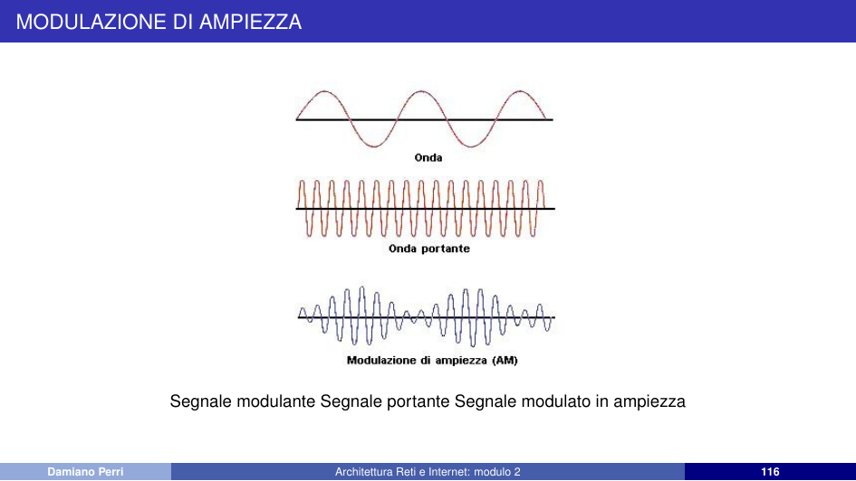

> [!warning] Attenzione:
> La modulazione AM è molto sensibile al rumore: l'informazione risiede nella variazione dell'ampiezza del segnale modulato, e il rumore che cade nella banda si somma ad esso degradando il contenuto informativo.

### FM (Modulazione di frequenza)

L'ampiezza resta standard, ma la frequenza del segnale cambia: l'onda si infittisce all'aumento dell'onda modulante e si rarefà quando l'onda modulante discende. Ha un'efficienza molto maggiore rispetto alla modulazione di ampiezza e risente meno dei disturbi, tuttavia necessita di circuiti molto più complicati. In Italia è usata per le trasmissioni radiofoniche nella banda 87,5–108 MHz.

Consiste nel far variare la frequenza della portante proporzionalmente al valore istantaneo del segnale modulante, lasciandone inalterata l'ampiezza $V_P$.

Segnale modulante e portante:
$$v_m(t) = V_M \sin(\omega_m t), \quad v_p(t) = V_P \sin(\omega_p t)$$

Segnale modulato in frequenza:
$$v_{FM}(t) = V_P \sin(\omega_p t + m_f \sin(\omega_m t))$$

Indice di modulazione di frequenza ($K_f$ sensibilità, $\Delta f$ deviazione):
$$m_f = \frac{K_f V_M}{\omega_m} = \frac{K_f V_M}{2\pi f_m} = \frac{\Delta f}{f_m}$$

  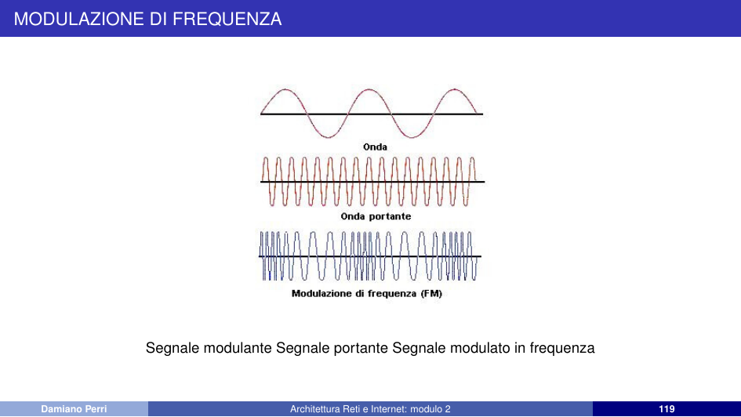

### PM (Modulazione di fase)

Modulazione molto simile alla FM, entrambe vanno sotto il nome di *modulazioni angolari*. Si distinguono per le bande di frequenza del segnale modulato e per il fatto che la frequenza portante nella PM è più stabile di quella della FM. Il sistema in PM è spesso utilizzato per ottenere l'amplificazione del segnale in sistemi in FM.

Nella modulazione di fase si fa variare la fase della portante in modo direttamente proporzionale all'ampiezza della modulante.

Segnale modulato in fase:
$$v_{PM}(t) = V_p \cos(\omega_p t + K_p V_m \sin(\omega_m t))$$

Dove:
- $V_p$, $\omega_p$: ampiezza costante e pulsazione della portante
- $K_p$: costante di sensibilità del modulatore di fase
- $m_p = K_p V_m$: indice di modulazione di fase

  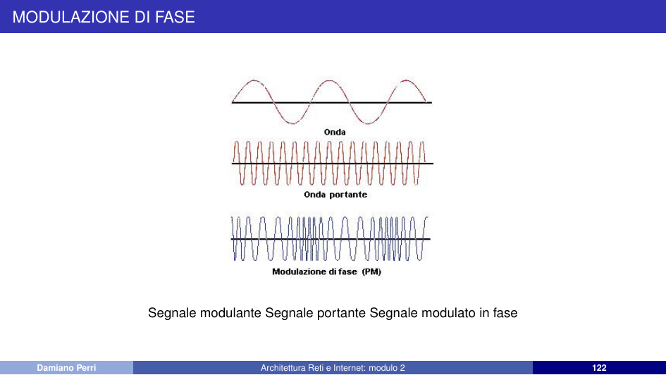

## Modulazione impulsiva

Tipo di modulazione in cui l'informazione è codificata in una serie di impulsi. I principali tipi:

- **PAM** (*Pulse Amplitude Modulation*) – modulazione ad ampiezza di impulso: il segnale analogico modulante varia l'ampiezza del treno di impulsi che costituisce la portante.

  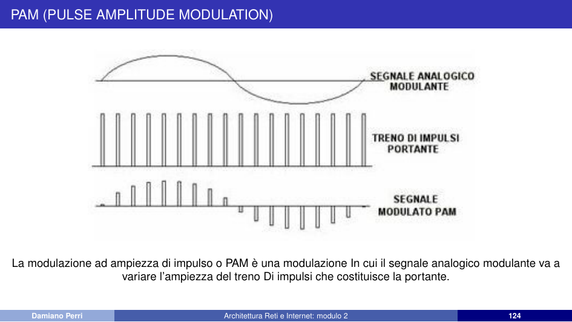

- **PWM** (*Pulse Width Modulation*) – modulazione a larghezza di impulso: l'informazione è codificata sotto forma di durata temporale degli impulsi; il segnale modulante varia la larghezza (durata) degli impulsi.

  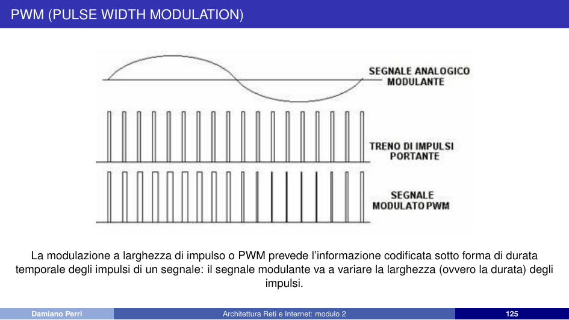

- **PPM** (*Pulse Position Modulation*) – modulazione a posizione di impulso: ampiezze e durate degli impulsi sono identiche, ma è modificata la loro posizione in base al segnale della modulante. Quanto più il segnale analogico è positivo, tanto più è ritardata la posizione degli impulsi rispetto a quella di riposo, e viceversa.

  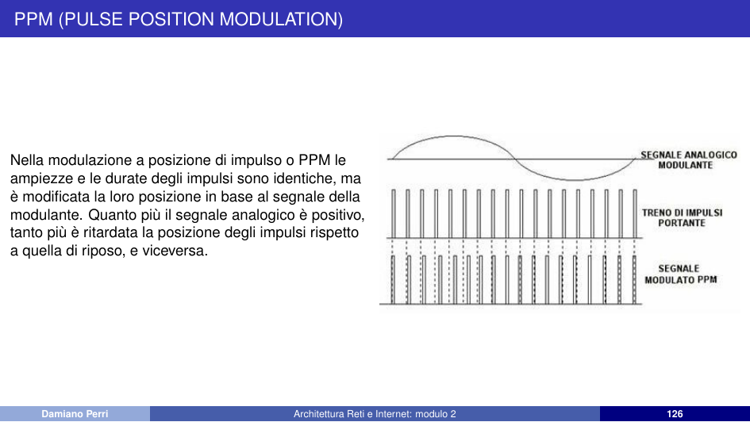

- **PCM** (*Pulse Code Modulation*) – modulazione codificata di impulsi: rappresenta tuttora lo standard per la digitalizzazione dei canali telefonici.

Intorno agli anni quaranta nacque l'esigenza di aumentare il numero di collegamenti telefonici interurbani. Si pensò a multiplare un gran numero di collegamenti su un solo cavo coassiale:
- **FDM** (*Frequency Division Multiplexing*): multiplex a divisione di frequenza, con limitazioni dovute a diafonia e rumore.
- **TDM** (*Time Division Multiplexing*): multiplex a divisione di tempo, sperimentato con le tecniche impulsive (PAM, PWM, PPM).
- Le tecniche impulsive furono presto superate dal **PCM**.

  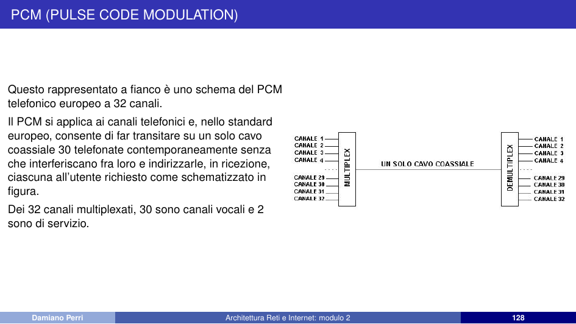

Lo schema del PCM telefonico europeo a 32 canali consente di far transitare su un solo cavo coassiale 30 telefonate contemporaneamente senza che interferiscano fra loro e indirizzarle, in ricezione, ciascuna all'utente richiesto. Dei 32 canali multiplexati, 30 sono canali vocali e 2 sono di servizio.

> [!info] Sintesi:
> - La serie di Fourier scompone un segnale periodico in sinusoidi; più armoniche = approssimazione migliore
> - Quattro tipi di filtri: passa-basso, passa-alto, passa-banda, elimina-banda (notch)
> - Modulazione: converte segnale digitale per trasmissione in banda limitata (AM, FM, PM, impulsiva)
> - AM: varia ampiezza, sensibile al rumore; FM: varia frequenza, più robusta; PM: varia fase, portante stabile
> - Modulazioni impulsive: PAM (ampiezza), PWM (larghezza), PPM (posizione), PCM (codificata, standard telefonico)
> - PCM europeo: 32 canali multiplexati (30 vocali + 2 servizio) su singolo cavo coassiale