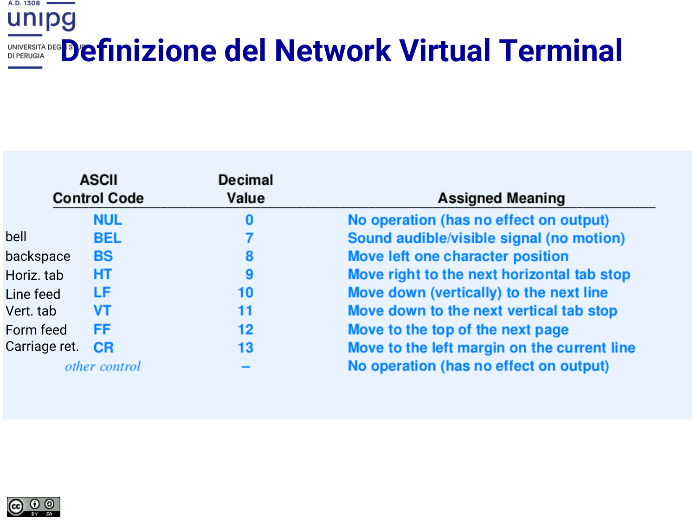
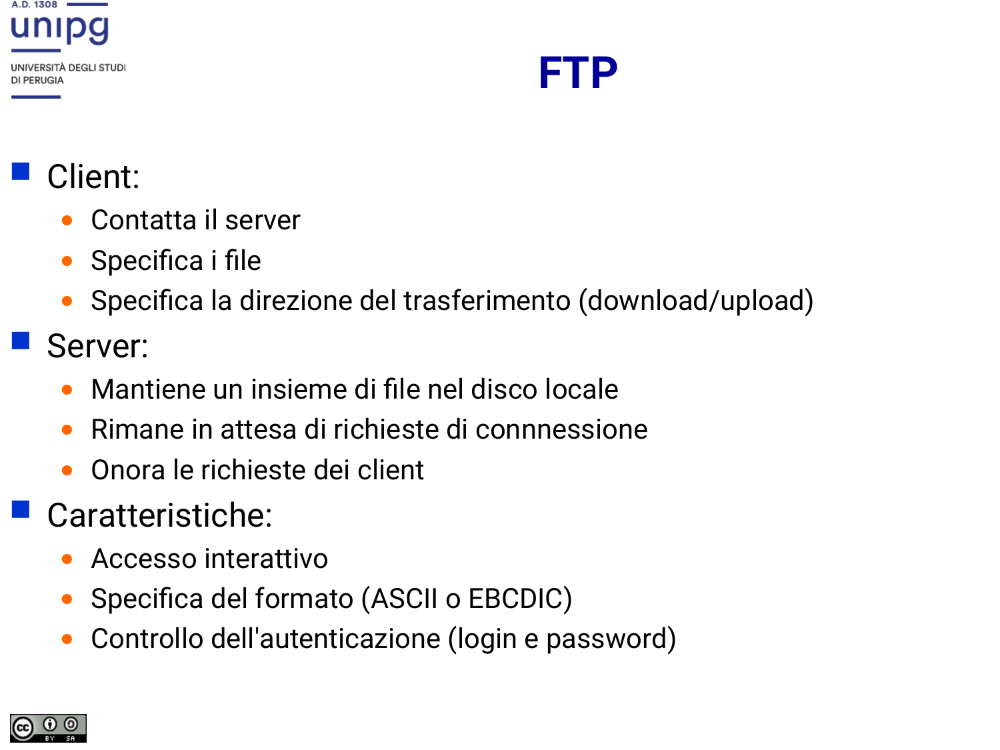
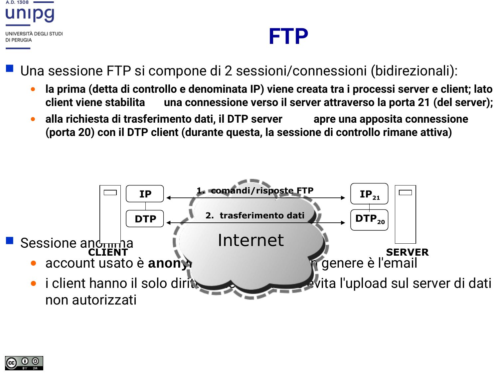
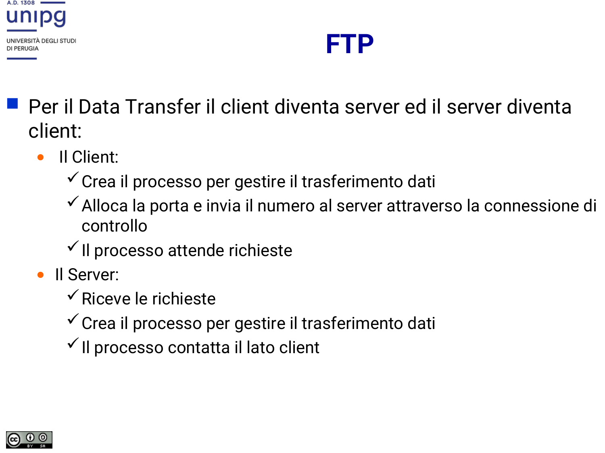
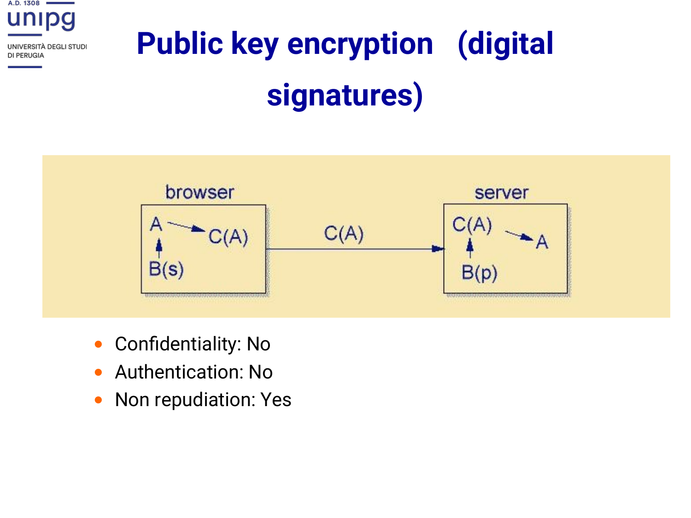
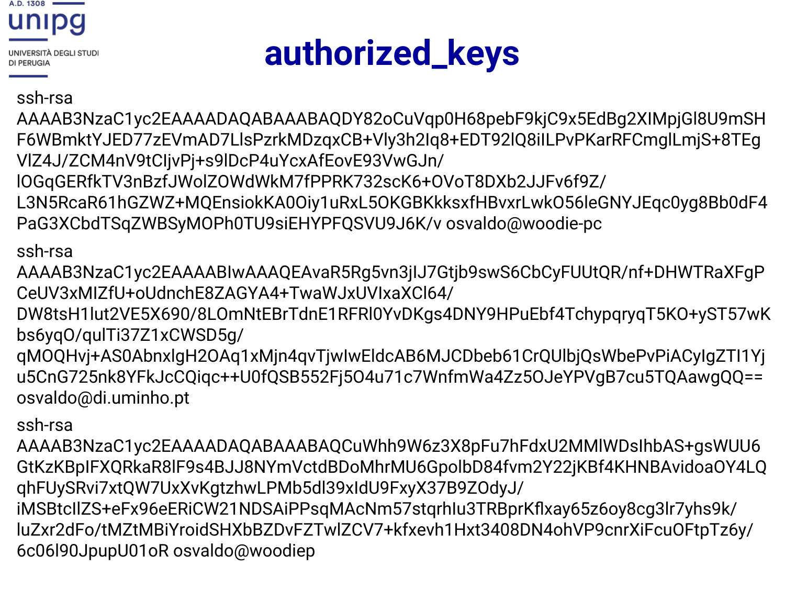

# Telnet, SSH e FTP

## Telnet

*Definizione:* servizio di rete di emulazione di un terminale a caratteri (ASCII), definito da RFC 854 e RFC 855. Effettua l'astrazione del terminale consentendo l'accesso interattivo remoto attraverso la rete.

Si basa sul protocollo di trasporto [[Lezione 6-UDP e TCP e routing|TCP]], garantendo una connessione affidabile e orientata alla connessione:
- **Client Telnet:** invocato dall'utente, si connette al server Telnet in esecuzione su un host remoto in ascolto sulla porta standard 23 TCP. Passa i caratteri digitati dalla tastiera al server e visualizza sulla finestra locale l'output restituito.
- **Server Telnet:** accetta la connessione di rete, inoltra i caratteri ricevuti al sistema operativo locale come se fossero digitati da una tastiera fisica locale, e invia l'output generato sulla connessione TCP verso il client.
- Appena connesso, l'utente può autenticarsi ed eseguire comandi sulla macchina remota esattamente come su un terminale locale.

Il servizio si basa su tre aspetti architetturali:
1. **Network Virtual Terminal (NVT):** terminale virtuale con caratteristiche generali condivise. Ogni client o server traduce i caratteri e le sequenze di controllo native della propria piattaforma in quelle standard del NVT. Questo elimina la dipendenza da specifici terminali hardware o emulatori proprietari.
2. **Opzioni negoziate:** meccanismo simmetrico che permette a client e server di negoziare estensioni funzionali della sessione Telnet (es. dimensione del terminale, modalità terminale a blocchi o a caratteri, echo locale/remoto). La negoziazione simmetrica richiede attenzione nell'implementazione per evitare cicli infiniti di richiesta e risposta.
3. **Viste simmetriche:** ai due capi della comunicazione operano programmi software equivalenti anziché vincoli rigidi hardware (monitor e tastiera fisici).

**Codici di controllo ASCII nell'NVT:** il terminale virtuale assegna un significato preciso ai caratteri di controllo ASCII:

| Codice | Decimale | Significato |
|---|---|---|
| `NUL` | 0 | Nessuna operazione (nessun effetto sull'output) |
| `BEL` (bell) | 7 | Segnale acustico o visivo (nessun movimento) |
| `BS` (backspace) | 8 | Sposta a sinistra di un carattere |
| `HT` (tab orizzontale) | 9 | Sposta alla tabulazione orizzontale successiva |
| `LF` (line feed) | 10 | Sposta in basso (verticalmente) alla riga successiva |
| `VT` (tab verticale) | 11 | Sposta alla tabulazione verticale successiva |
| `FF` (form feed) | 12 | Sposta all'inizio della pagina successiva |
| `CR` (carriage return) | 13 | Sposta al margine sinistro della riga corrente |
| altri caratteri di controllo | – | Nessuna operazione |

<div style="display: flex; justify-content: center;">
  
</div>

### Funzioni di controllo NVT

Dovendo operare su sistemi eterogenei con convenzioni di tastiera differenti, il protocollo standardizza 7 funzioni di controllo fondamentali:

| Segnale | Nome per esteso | Significato |
|---|---|---|
| `IP` | *Interrupt Process* | Termina il programma in esecuzione sul sistema remoto. |
| `AO` | *Abort Output* | Scarta l'output memorizzato nei buffer senza terminare il processo. |
| `AYT` | *Are You There* | Verifica se il server o il processo remoto è ancora attivo e risponde. |
| `EC` | *Erase Character* | Cancella l'ultimo carattere digitato prima del cursore. |
| `EL` | *Erase Line* | Cancella l'intera riga corrente. |
| `SYNCH` | *Synchronize* | Svuota il flusso dati fino al puntatore *TCP Urgent Data*, continuando a interpretare i comandi di controllo. |
| `BRK` | *Break* | Invia il segnale di break o richiesta di attenzione al sistema operativo remoto. |

### Comandi Telnet

I comandi nel flusso dati sono introdotti dal byte speciale `IAC` (*Interpret As Command*, codice decimale 255). Se il byte 255 compare come dato effettivo, il mittente lo raddoppia (`IAC IAC`):

| Comando | Codice Decimale | Significato |
|---|---|---|
| `IAC` | 255 | Interpreta il byte successivo come comando. |
| `DONT` | 254 | Diniego o richiesta di non abilitare l'opzione specificata. |
| `DO` | 253 | Approvazione o richiesta di abilitare l'opzione specificata. |
| `WONT` | 252 | Rifiuto di abilitare l'opzione da parte del mittente. |
| `WILL` | 251 | Disponibilità ad abilitare l'opzione da parte del mittente. |
| `SB` | 250 | *Start Subnegotiation:* inizio della sotto-negoziazione dei parametri dell'opzione. |
| `GA` | 249 | *Go Ahead:* segnale di via libera per trasmissioni half-duplex. |
| `EL` | 248 | Segnale *Erase Line*. |
| `EC` | 247 | Segnale *Erase Character*. |
| `AYT` | 246 | Segnale *Are You There*. |
| `AO` | 245 | Segnale *Abort Output*. |
| `IP` | 244 | Segnale *Interrupt Process*. |
| `BRK` | 243 | Segnale *Break*. |
| `DMARK` | 242 | Porzione dati di un segnale `SYNCH` (accompagnato da TCP Urgent). |
| `NOP` | 241 | *No Operation*: nessuna operazione. |
| `SE` | 240 | *Subnegotiation End:* termine della sotto-negoziazione dell'opzione. |
| `EOR` | 239 | *End of Record:* fine record logico. |

## Rlogin e remote shell

**Rlogin:**
- Introdotto nei sistemi BSD Unix con facilitazioni specifiche per ambienti omogenei Unix.
- Consente all'amministratore di configurare un trust tra macchine (`.rhosts` e `/etc/hosts.equiv`): se l'utente possiede lo stesso identificativo (UID/username) su macchine diverse della rete, l'accesso remoto avviene senza richiedere la digitazione della password.
- *Problemi di sicurezza:* la verifica dell'identità si basa sull'indirizzo IP del client, esponendo il sistema ad attacchi di IP spoofing e intercettazione credenziali.

**Remote Shell (rsh):**
- Componente della suite BSD Unix, strettamente correlato a rlogin.
- Esegue un singolo comando su un host remoto e restituisce direttamente lo standard output e lo standard error sulla finestra del terminale locale.
- Condivide lo stesso modello di autenticazione debole basato su indirizzo IP e file di configurazione utente.

**Port forwarding:**
- E' una nuova funzionalità implementata da ssh (secure shell)
- E' simile al Network Address Translation (NAT)
- Permette di istradare connessioni TCP in un canale cifrato

## Remote desktop

Protocolli per l'accesso remoto a sistemi con interfaccia grafica a finestre (GUI). Consentono di visualizzare lo schermo remoto e inoltrare gli input di mouse e tastiera attraverso la rete:
- *Virtual Network Computing (VNC):* protocollo indipendente dalla piattaforma, trasmette frame buffer grafici compressi.
- *Remote Desktop Protocol (RDP):* protocollo proprietario Microsoft per ambienti Windows, trasmette istruzioni di rendering grafico ottimizzate.
- *X Window System (X11):* architettura nativa Unix/Linux, in cui il server grafico gira sulla macchina locale dell'utente e i client applicativi remoti inviano comandi grafici sulla rete.

## Obsolescenza di Telnet

Telnet e la suite `r*` (rlogin, rsh, rcp) trasmettono l'intero flusso dati in chiaro sulla rete:
- Qualsiasi dispositivo intermedio lungo il percorso o su una LAN condivisa può catturare username, password di sessione e dati riservati tramite strumenti di *packet sniffing* (es. Wireshark o tcpdump).
- Nei sistemi operativi moderni i server Telnet e rlogin sono disabilitati o bloccati per impostazione predefinita. Un tentativo di connessione su porta 23 restituisce normalmente:
  ```text
  osvaldo@woodiep:~$ telnet localhost
  Trying 127.0.0.1...
  telnet: Unable to connect to remote host: Connection refused
  ```
- La totalità dell'accesso remoto a terminale a riga di comando è sostituita da **SSH (Secure Shell)**, che garantisce canale cifrato, integrità dei dati e autenticazione forte del server e del client.
- Su ambienti Windows il client classico è PuTTY, mentre su Linux, macOS e Unix si utilizza la suite OpenSSH.

## File Transfer Protocol (FTP)

*Definizione:* protocollo applicativo per il trasferimento di file tra host in una rete TCP/IP, standardizzato da RFC 959. Basato su connessione TCP affidabile.

**Ruoli di client e server:**
- **Client:** contatta il server, specifica il file e la direzione del trasferimento (download/upload).
- **Server:** mantiene un insieme di file nel disco locale, rimane in attesa di richieste di connessione e onora le richieste dei client.
- **Caratteristiche:** accesso interattivo, specifica del formato (ASCII o EBCDIC), controllo dell'autenticazione (login e password).

<div style="display: flex; justify-content: center;">
  
</div>

### Architettura a doppia connessione

In una sessione FTP intervengono due processi distinti sia lato client che lato server:
- **Protocol Interpreter (PI):** interpreta i comandi di controllo scambiati tra client e server e gestisce lo stato della sessione.
- **Data Transfer Process (DTP):** gestisce il trasferimento effettivo dei blocchi dati del file.

<div style="display: flex; justify-content: center;">
  
</div>

Una sessione FTP utilizza due connessioni TCP indipendenti:
1. **Connessione di controllo (porta 21 TCP del server):** stabilita all'avvio dal client verso la porta 21 del server. Rimane sempre aperta per l'intera durata della sessione per inviare comandi testuali e ricevere i codici di risposta a tre cifre.
2. **Connessione dati (porta 20 TCP del server o porta effimera):** aperta solo al momento del trasferimento effettivo di un file o dell'elenco di directory (`LIST`), e chiusa al termine del trasferimento stesso.

**Sessione anonima:** accesso pubblico con username `anonymous` (password convenzionale coincidente con l'indirizzo email). I permessi del client sono limitati alla sola lettura (download), impedendo l'upload non autorizzato di dati sul server.

### Modalità attiva e passiva

Nel trasferimento dati, il ruolo di chi effettua la connessione TCP si inverte a seconda della modalità:

- **Modalità attiva (Active Mode):**
  1. Il client apre una porta locale non privilegiata $N$ per la connessione dati e invia al server sulla connessione di controllo il comando `PORT IP,p1,p2` specificando il proprio indirizzo e la porta $N = p1 \times 256 + p2$.
  2. Il server dà inizio alla connessione dati partendo dalla porta TCP 20 verso la porta $N$ indicata dal client.
  3. *Limite:* se il client si trova dietro un firewall o un router [[Lezione 11-SNMP e DHCP#Network Address Translation (NAT)|NAT]], la connessione in ingresso avviata dal server verso la porta interna del client viene respinta o bloccata.

<div style="display: flex; justify-content: center;">
  
</div>

- **Modalità passiva (Passive Mode):**
  1. Il client invia sulla connessione di controllo il comando `PASV`.
  2. Il server alloca una porta effimera casuale $P$ e risponde al client con `227 Entering Passive Mode (IP,p1,p2)`.
  3. È il client a iniziare la connessione dati collegandosi dalla propria porta locale verso la porta $P$ aperta sul server.
  4. Risolve le problematiche legate a firewall e NAT lato client, poiché entrambe le connessioni (controllo e dati) sono originate in uscita dal client verso il server.

> [!info] Uso interattivo di FTP
> - All'inizio in protocollo FTP era usato da linea di comando:
> 	- L'utente invoca il client e specifica il server remoto
> 	- L'Utente si collega e immette la password
> 	- L'Utente specifica una serie di richieste
> 	- L'Utente chiude la connessione
> - Oggi:
> 	- Gran parte delle richieste FTP originano da browser
> 	- L'Utente specifica la URL o click sul link
> 	- Il Browser usa FTP per contattare il server remoto ed ottiene: la lista dei files e l'utente seleziona il file per il download

### Comandi FTP principali

- **Controllo accesso:**
  - `OPEN host`: stabilisce la sessione verso il server remoto.
  - `USER utente`: specifica l'identificativo utente.
  - `PASS password`: invia la password di autenticazione.
  - `QUIT`: chiude le connessioni e termina la sessione FTP.
- **Configurazione parametri:**
  - `PORT IP+porta`: specifica la porta dati allocata dal client (modalità attiva).
  - `PASV`: richiede al server di predisporre la porta dati (modalità passiva).
  - `TYPE`: imposta la modalità di codifica dei dati (`A` per ASCII, `I` per immagine/binario).
- **Trasferimento file:**
  - `RECV remoto locale` (o `GET`): scarica il file dal server al client.
  - `SEND locale remoto` (o `PUT`): carica il file dal client al server.
- **Gestione file e directory sul server:**
  - `DELETE file`: elimina un file remoto.
  - `CD directory`: cambia la directory di lavoro remota.
  - `MKDIR / RMDIR`: crea o rimuove una directory remota.
  - `LS / DIR`: elenca i file e le cartelle sul server remoto.

### Sicurezza in FTP (RFC 2228)

Nelle specifiche RFC 959 le credenziali e i dati viaggiano in chiaro. RFC 2228 introduce estensioni di sicurezza:
- `AUTH tipo`: specifica il meccanismo di autenticazione e sicurezza da negoziare (es. TLS).
- `PROT livello`: livello di protezione applicato al canale dati:
  - `Clear`: nessuna protezione (in chiaro).
  - `Safety`: verifica dell'integrità dei dati tramite checksum/digest.
  - `Confidential`: cifratura dei dati (riservatezza).
  - `Private`: cifratura e verifica di integrità simultanee.
- `MIC`: comando per trasferire dati con livello di sicurezza *Safety*.
- `CONF`: comando per trasferire dati con livello di sicurezza *Confidential*.
- `ENC`: comando per trasferire dati con livello di sicurezza *Private*.
- Strumenti operativi: su Linux si utilizzano client a canale cifrato come `sftp` e `scp` (basati su SSH); su Windows strumenti come WinSCP o PSFTP.

### Sicurezza di telnet e FTP

- Presentano l’inconveniente che il traffico attraversa la rete in chiaro, pertanto si presta a violazioni di dati sensibili (login, password, dati sensibili in generale)
- Meglio utilizzare le versioni che utilizzano ssh (Secure Shell) e scp (Secure Copy), che scambiano i dati in modo cifrato. Queste procedure generano un maggior carico computazionale sia sul server che sul client. Molti software che implementano ambienti client di questi servizi hanno la possibilità di usare la versione sicura
- I socket ssh e scp in genere sono lasciati aperti sui firewall

## Protocollo TFTP

*Definizione:* protocollo di trasferimento file leggero (RFC 1350), alternativo a FTP:
- Basato su [[Lezione 6-UDP e TCP e routing|UDP]] (porta 69), orientato a reti locali (LAN).
- Non prevede alcuna procedura di autenticazione né comandi per navigare o elencare le directory (supporta solo lettura e scrittura di file interi).
- Protocollo lock-step: ogni blocco di dati trasmesso (512 byte) deve essere confermato da un pacchetto di acknowledge (ACK) prima dell'invio del blocco successivo.
- Codice estremamente compatto, implementabile direttamente nei chip di ROM/firmware di schede di rete e dispositivi embedded: impiegato principalmente per il bootstrap di stazioni di lavoro senza disco (*diskless*) e per caricare configurazioni su router e switch.

## Tecnologie di crittografia

### Crittografia simmetrica (chiave condivisa)

Utilizza la medesima chiave segreta sia per la cifratura del messaggio che per la decifratura:
- *Algoritmi:* DES (Data Encryption Standard), 3DES (Triple DES), AES (Advanced Encryption Standard), Blowfish.
- *Vantaggi:* elevatissima efficienza computazionale e velocità di elaborazione di grandi volumi di dati.
- *Svantaggi:* problema critico della distribuzione sicura della chiave segreta condivisa tra i due interlocutori attraverso un canale non sicuro.

### Crittografia asimmetrica (chiave pubblica)

Ciascun interlocutore genera una coppia di chiavi matematicamente correlate:
- **Chiave pubblica:** resa nota a chiunque, registrata in elenchi pubblici o distribuita liberamente.
- **Chiave privata:** mantenuta rigorosamente segreta dal legittimo proprietario.
- *Algoritmi:* RSA, Diffie-Hellman (DH), Digital Signature Algorithm (DSA), crittografia a curve ellittiche (ECDSA/Ed25519).

<div style="display: flex; justify-content: center;">
  
</div>

La crittografia asimmetrica risolve tre requisiti di sicurezza a seconda di quale chiave viene impiegata nella cifratura:

| Meccanismo | Cifratura eseguita con | Decifratura eseguita con | Riservatezza (*Confidentiality*) | Autenticazione (*Authentication*) | Non ripudio (*Non-repudiation*) |
|---|---|---|---|---|---|
| Cifratura convenzionale | Chiave pubblica del destinatario | Chiave privata del destinatario | Sì | No | No |
| Firma digitale | Chiave privata del mittente | Chiave pubblica del mittente | No | No | Sì |
| Firma e Cifratura combinate | Privata mittente + Pubblica destinatario | Privata destinatario + Pubblica mittente | Sì | Sì | Sì |

> [!todo] Firma digitale e autenticazione: la slide del docente indica *Authentication: No* (riportato in tabella); le fonti comuni la considerano invece un meccanismo di autenticazione del mittente. Verificare a lezione.

## OpenSSH

Implementazione open-source dei protocolli SSH, sviluppata all'interno del progetto OpenBSD e fondata sulla libreria crittografica OpenSSL.

### Versioni SSH1 e SSH2

- **SSH versione 1 (1.3 e 1.5):**
  - Utilizza RSA per lo scambio e la negoziazione delle chiavi di sessione.
  - Cifra i dati con algoritmi simmetrici (3DES, AES, Blowfish; non supporta IDEA per motivi di brevetto).
  - Verifica l'integrità tramite CRC (Cyclic Redundancy Check), vulnerabile ad attacchi di manipolazione di pacchetto.
- **SSH versione 2 (SSH2):**
  - Standard IETF incompatibile con SSH1, progettato per superare le limitazioni di brevetto e le debolezze architetturali.
  - Utilizza DSA ed algoritmi basati su scambio Diffie-Hellman (DH) per la negoziazione iniziale delle chiavi.
  - Sostituisce il CRC con codici di autenticazione crittografici HMAC (Keyed-Hash Message Authentication Code).
  - Si interfaccia diffusamente con le librerie OpenSSL.

### Gestione delle chiavi e configurazione

SSH memorizza le configurazioni e i certificati nella directory locale `$HOME/.ssh`, che deve avere permessi restrittivi `700` (`rwx------`):
- `known_hosts`: contiene le chiavi pubbliche e gli indirizzi IP dei server remoti a cui il client si è precedentemente collegato. Protegge da attacchi Man-in-the-Middle (se la chiave del server cambia all'improvviso, il client rifiuta la connessione segnalando una potenziale violazione).
- `authorized_keys`: memorizza sul server remoto l'elenco delle chiavi pubbliche degli utenti autorizzati ad accedere all'account. Se la chiave pubblica del client è registrata nel file, l'autenticazione avviene senza password (autenticazione a chiave pubblica).
- Generazione chiavi: eseguita con il comando `ssh-keygen -t rsa` (o `-t ed25519`), che produce una coppia formata da chiave privata (`id_rsa`, con permessi `600`) e chiave pubblica (`id_rsa.pub`).

<div style="display: flex; justify-content: center;">
  
</div>

### Componenti della suite OpenSSH

- `ssh`: client per sessioni remote interattive (sostituisce Telnet ed rlogin).
- `scp`: utility per la copia sicura di file remoti su canale cifrato SSH (sostituisce rcp).
- `sftp`: client per il trasferimento interattivo di file tramite sottosistema SSH (sostituisce FTP).
- `sshd`: demone in esecuzione sui server per gestire le connessioni SSH in ingresso.
- `ssh-keygen`: programma di utilità per creare le coppie di chiavi asimmetriche.
- `ssh-add` e `ssh-agent`: gestori per mantenere le chiavi private decifrate in memoria durante la sessione di lavoro dell'utente.
- `sftp-server`: sottosistema server che gestisce le richieste SFTP avviate dai client.

### Demone sshd e configurazione

Il server `sshd` è configurato attraverso il file `/etc/ssh/sshd_config`. Le direttive fondamentali includono:
- `PermitRootLogin without-password` (o `prohibit-password`): impedisce il login diretto dell'amministratore `root` con password, consentendolo solo tramite autenticazione a chiave pubblica.
- `MaxAuthTries 3`: limita a 3 i tentativi di autenticazione consentiti per connessione.
- `AuthorizedKeysFile .ssh/authorized_keys`: specifica il percorso del file contenente le chiavi pubbliche autorizzate per ciascun utente.
- `PasswordAuthentication yes` / `no`: abilita o disabilita l'autenticazione interattiva tramite password.
- `X11Forwarding yes`: consente di inoltrare le connessioni grafiche del server X Window attraverso il tunnel sicuro SSH.
- `Subsystem sftp /usr/libexec/openssh/sftp-server`: specifica il binario che implementa il protocollo SFTP per i client collegati.

### SSH port forwarding

Funzionalità che consente di incapsulare e instradare qualsiasi connessione TCP arbitraria all'interno di un canale crittografato SSH, aggirando firewall o NAT:
- **Local port forwarding (`-L`):** il client SSH apre una porta locale e inoltra tutto il traffico ricevuto verso una specifica porta dell'host remoto passando per il tunnel SSH.
- **Remote port forwarding (`-R`):** il server SSH apre una porta remota e inoltra le connessioni in ingresso verso una porta accessibile dal client.
- **Dynamic port forwarding (`-D`):** configura il client SSH come server proxy SOCKS locale, consentendo a browser e applicazioni di instradare dinamicamente qualsiasi traffico TCP attraverso la macchina remota.
