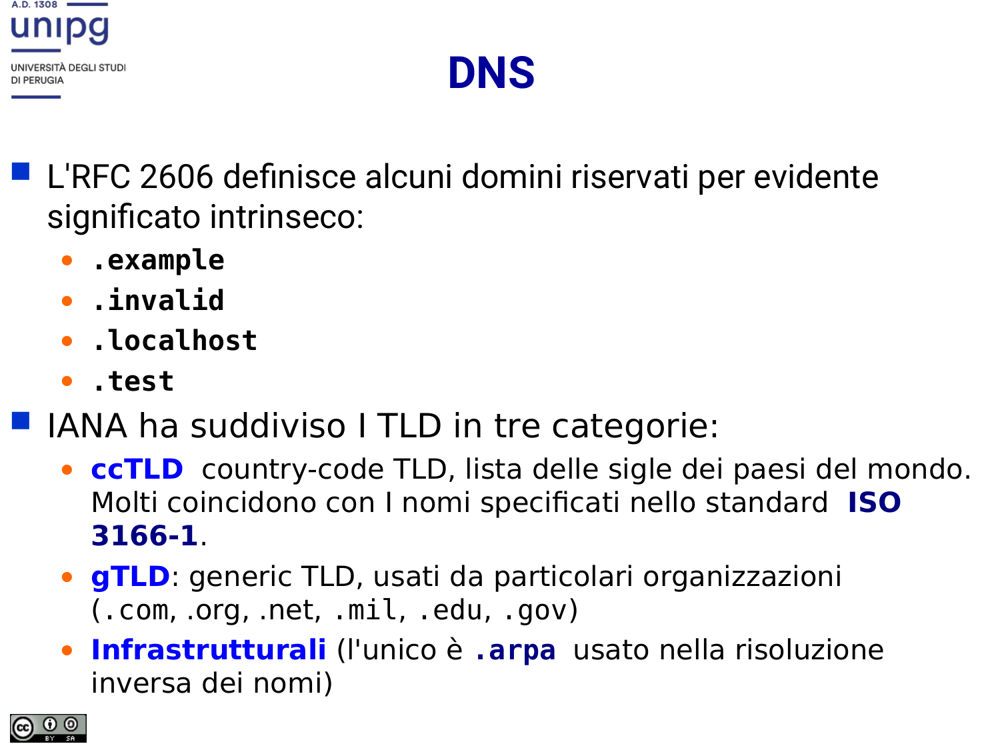
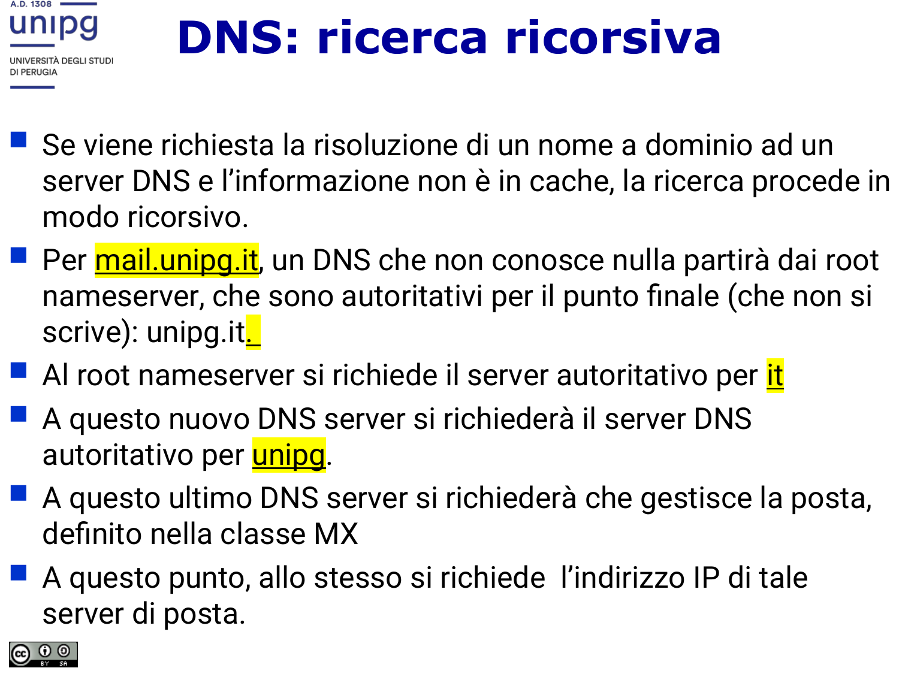
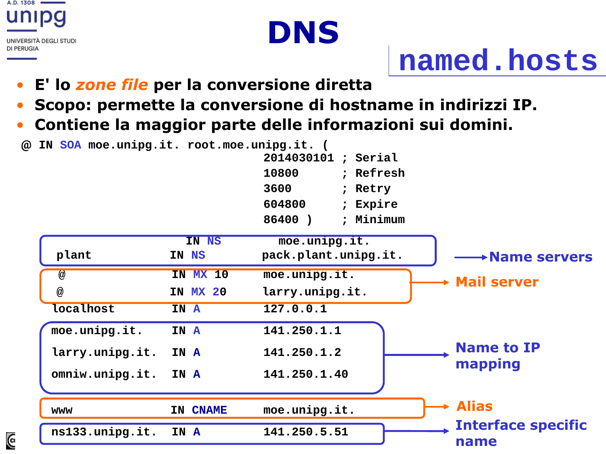

# Domain Name System (DNS)

## Spazio dei nomi e FQDN

Gli utenti memorizzano e utilizzano nomi simbolici (*hostname*), mentre i protocolli di rete identificano le interfacce tramite indirizzi IP numerici. L'associazione tra nomi e indirizzi può essere organizzata secondo due modelli:

- **Spazio dei nomi piatto:** nomi costituiti da una singola stringa non strutturata. Non scala: richiede un'autorità centrale che garantisca l'univocità globale, generando colli di bottiglia e conflitti di denominazione.
- **Spazio dei nomi gerarchico:** nomi strutturati ad albero invertito con radice convenzionale nulla `.`. La suddivisione può seguire la topologia fisica della rete oppure la struttura delle organizzazioni (indipendente dalle interconnessioni fisiche delle reti).

Internet adotta una suddivisione gerarchica per **organizzazione**, indipendente dalla topologia fisica dei collegamenti: ciascuna organizzazione amministra la propria porzione di albero in piena autonomia.

**Nome a dominio pienamente qualificato (FQDN):**
Sequenza di etichette (*labels*) separate dal carattere punto (`.`), lette da sinistra verso destra dal nodo foglia fino alla radice (es. `dmi.unipg.it.`, dove il punto finale rappresenta la radice ed è normalmente omesso nella digitazione comune):

- Profondità massima dell'albero: 127 livelli.
- Lunghezza massima di ciascuna etichetta: 63 byte (caratteri).
- Lunghezza massima complessiva dell'FQDN: 255 byte.

<div style="display: flex; justify-content: center;">
  
</div>

### Classificazione dei Top-Level Domains (TLD)

I domini di primo livello sono governati da ICANN (storicamente da IANA) e si suddividono in tre categorie:

1. **ccTLD (*country-code TLD*):** codici a due lettere corrispondenti alle nazioni del mondo, basati sullo standard ISO 3166-1 (`.it`, `.fr`, `.uk`, `.de`).
2. **gTLD (*generic TLD*):** domini generici associati a specifiche categorie di organizzazioni (`.com` commerciale, `.org` no-profit, `.net` infrastrutture di rete, `.edu` istruzione/università USA, `.gov` governo USA, `.mil` forze armate USA), a cui si sono aggiunti numerosi gTLD tematici di nuova generazione.
3. **Infrastrutturali:** dominio riservato `.arpa`, impiegato per la risoluzione inversa (*Reverse DNS*) e per parametri architetturali del routing Internet.

*Domini riservati (RFC 2606):* per scopi di test e documentazione sono permanentemente riservati `.example`, `.invalid`, `.localhost`, `.test`.

<div style="display: flex; justify-content: center;">
  
</div>

Si pensava (impropriamente) che senza l'aggiunta di nuovi nomi, il DNS sarebbe collassato. Ora il proliferare dei nomi sta creando grossi problemi legali. Diventa impossibile proteggere un brand in questo modo.

## Autorità e delega dei nomi

L'assegnazione dei nomi opera mediante un modello di delega amministrativa e tecnica a cascata:

1. Un'organizzazione contatta un ente accreditato (*registrar*) per registrare un dominio di secondo livello (es. l'Università degli Studi di Perugia registra `unipg.it`).
2. L'Università diventa responsabile tecnica ed amministrativa della zona `unipg.it`.
3. Strutture interne possono richiedere un sottodominio di terzo livello (es. il Dipartimento di Matematica e Informatica ottiene `dmi.unipg.it`), ricevendo la delega per gestire i propri server DNS.
4. I singoli host e server della struttura vengono battezzati dall'amministratore locale assegnando indirizzo IP e hostname corrispondente.

## Database DNS

Le definizioni inerenti un dominio internet (ad es. `unipg.it`) sono contenute in un file di testo denominato **zone file**.

Uno zone file è costituito da:

- **Record**
- **Nomi**
- **Classi**

Un certo nome può essere associato a diverse classi (host, mail exchanger, server DNS, ecc.) del DNS. Il client specifica il tipo di classe richiesta una volta che chiede di risolvere il nome, il server ritorna la descrizione della classe specificata per quel nome.

### Associazione nome-indirizzo

È possibile associare ad ogni interfaccia di rete, in reti di tipo TCP/IP, ad ogni IP address, un nome: **hostname**.

Perché si fa questo? Perché i nomi sono più facili da ricordare e da scrivere correttamente rispetto agli indirizzi numerici.

- Es: `141.250.1.7` oppure `teseo.unipg.it`

Dando un nome ad ogni interfaccia, quando si esegue un comando come `traceroute`, il percorso appare più chiaro.

Quasi sempre gli indirizzi numerici e i nomi sono intercambiabili, ma in tutti i casi prima di effettuare una connessione il sistema converte l'hostname in un IP address.

L'amministratore di rete è responsabile dell'assegnazione dei nomi e degli indirizzi e della loro memorizzazione.

La traduzione di nomi in indirizzi deve essere nota a tutti gli host della rete. Questo avviene con il componente DNS denominato **resolver**.

## Risoluzione dei nomi: statica vs dinamica

- **Risoluzione statica (`/etc/hosts`):** mapping (tra indirizzo IP e hostname) memorizzato in una tabella locale su ciascun host (in `/etc/hosts`).

  ```text
  # /etc/hosts
  127.0.0.1       localhost
  192.168.130.1   moe.unipg.it moe
  192.168.132.2   larry.unipg.it larry
  192.168.130.40  omniw.unipg.it omniw
  192.168.132.20  pserver.unipg.it pserver
  192.168.132.45  powerbook.unipg.it powerbook
  ```

  *Limiti:* ingestibile su scala geografica; ogni modifica richiede l'aggiornamento manuale di tutti gli host del pianeta.

- **Risoluzione dinamica (DNS):** architettura client/server distribuita in cui gli host interrogano server DNS autoritativi o di caching per ottenere la traduzione aggiornata in tempo reale.

  - L'associazione (mapping) tra indirizzo IP e hostname viene stabilito dinamicamente: ogni host, all'avvio, richiede al server DNS le informazioni sui nomi da assegnare alle proprie interfacce.
  - Attraverso il file di configurazione del resolver, ogni host sa quali server interrogare, e i server sanno quali nomi assegnare a ciascun indirizzo IP definito nello zone file associato al dominio del quale il server DNS è autoritativo.
  - A differenza della risoluzione statica, non serve aggiornare manualmente ogni host: basta modificare lo zone file sul server autoritativo e la traduzione diventa disponibile per tutti i client della rete.

## Risoluzione ricorsiva e iterativa

Quando un client richiede la risoluzione di un nome non presente nella memoria cache locale, il processo di interrogazione può svolgersi secondo due modalità:

- **Risoluzione ricorsiva:** il server DNS interrogato si fa interamente carico della risoluzione per conto del client. Se non possiede l'informazione, contatta a catena gli altri server fino a ottenere la risposta definitiva, restituendola al richiedente.
- **Risoluzione iterativa:** se il server interrogato non è autoritativo per la zona, restituisce al chiamante l'indirizzo del server DNS gerarchicamente più vicino (un *referral*), delegando al client o al resolver locale il compito di effettuare l'interrogazione successiva.

<div style="display: flex; justify-content: center;">
  
</div>

### Passaggi della ricerca ricorsiva (es. `mail.unipg.it`)

1. Il resolver dell'host interroga il DNS server locale.
2. Se il dato non è in cache, il server locale contatta uno dei **Root Name Servers** (autoritativi per `.`).
3. Il Root server non conosce `mail.unipg.it`, ma restituisce l'elenco dei server autoritativi per il TLD `.it`.
4. Il server locale interroga il server per `.it`, il quale delega e risponde indicando i server autoritativi per `unipg.it`.
5. Il server locale interroga il server autorevole di `unipg.it`, chiedendo il server di posta (record `MX`).
6. Ottenuto il nome del mail server, richiede allo stesso server autoritativo l'indirizzo IP corrispondente (record `A`).
7. La risposta finale viene restituita al client e memorizzata nella cache locale con il relativo Time-To-Live (TTL).

**Root Name Servers:** esistono 13 indirizzi logici storici (da `A.ROOT-SERVERS.NET` a `M.ROOT-SERVERS.NET`), ciascuno replicato su centinaia di nodi fisici nel mondo tramite instradamento [[Lezione 12-IPv6#Classificazione degli indirizzi IPv6|Anycast]]. I 13 indirizzi IP storici sono:

| Root | Indirizzo IP |
|---|---|
| `A.ROOT-SERVERS.NET` | 198.41.0.4 |
| `B.ROOT-SERVERS.NET` | 128.9.0.107 |
| `C.ROOT-SERVERS.NET` | 192.33.4.12 |
| `D.ROOT-SERVERS.NET` | 128.8.10.90 |
| `E.ROOT-SERVERS.NET` | 192.203.230.10 |
| `F.ROOT-SERVERS.NET` | 192.5.5.241 |
| `G.ROOT-SERVERS.NET` | 192.112.36.4 |
| `H.ROOT-SERVERS.NET` | 128.63.2.53 |
| `I.ROOT-SERVERS.NET` | 192.36.148.17 |
| `J.ROOT-SERVERS.NET` | 198.41.0.10 |
| `K.ROOT-SERVERS.NET` | 193.0.14.129 |
| `L.ROOT-SERVERS.NET` | 198.32.64.12 |
| `M.ROOT-SERVERS.NET` | 202.12.27.33 |

## Implementazione BIND su UNIX/Linux

L'implementazione standard del DNS in ambiente UNIX/Linux è **BIND** (*Berkeley Internet Name Domain*):

- Processo demone server: `named`.
- Libreria client: `resolver`.
- Strumenti di diagnosi e interrogazione: `dig`, `host`, `nslookup`.
- Release correnti: BIND 9.20.x (stable) e BIND 9.21.x (dev), con minor release che originano da security release o roll-up bugfix release.

### Configurazione del resolver client

Il resolver legge all'avvio i parametri memorizzati nel file `/etc/resolv.conf`:

- `nameserver IP`: indirizzo IP del server DNS da interrogare (possono esserne specificati fino a un massimo di 3; in caso di mancata risposta entro il timeout la richiesta scala al successivo).
- `domain nome`: dominio di default locale, aggiunto automaticamente a qualsiasi hostname privo di punti. Esempio: se il dominio è definito come `dmi.unipg.it`, per accedere a un servizio dell'host `cartesio.dmi.unipg.it` basta specificare il nome `cartesio`. Il resolver chiede di ottenere l'indirizzo IP di `cartesio.dmi.unipg.it`. In caso di fallimento richiede l'IP di `cartesio.unipg.it` e così a salire nella gerarchia.
- `search dominio1 dominio2 ...`: elenco di suffissi di dominio da tentare progressivamente nella ricerca di host non qualificati. Ha la stessa funzione di `domain` con la possibilità di avere più domini da provare ad aggiungere al nome dell'host. La differenza con `domain` è che viene aggiunto solo l'intero nome dei domini indicati.

```text
# /etc/resolv.conf
search dmi.unipg.it unipg.it
nameserver 141.250.1.7
nameserver 141.250.1.6
```

Verifica del corretto funzionamento:

```text
# host teseo
teseo.unipg.it is 141.250.1.7
```

> [!warning] Attenzione:
> Se l'host ottiene i parametri di rete via [[Lezione 11-SNMP e DHCP#Protocollo DHCP|DHCP]], il file `/etc/resolv.conf` viene sovrascritto a ogni rinnovo o connessione con i parametri inviati dal server DHCP.

Altri file di controllo del client includono `/etc/host.conf` e `/etc/nsswitch.conf`, che definiscono l'ordine di precedenza tra risoluzione statica (`files`) e dinamica (`dns`).

### Tipologie di server BIND

1. **Caching-only Server:** non possiede database autoritativi di zona. Interroga server remoti per soddisfare le richieste dei client locali e ne memorizza le risposte in memoria cache per il tempo stabilito dal TTL. Richiede solo `named.conf` e `named.ca`.
2. **Primary (Master) Server:** detiene la copia originale e autoritativa dei file di zona (*zone files*), compilati e modificati manualmente dall'amministratore.
3. **Secondary (Slave) Server:** mantiene una replica esatta della zona scaricandola dal server primario tramite una procedura di trasferimento di zona (*Zone Transfer*, protocollo AXFR o IXFR incrementale). Garantisce ridondanza e bilanciamento del carico.

### File di configurazione di named

- `/etc/named.conf`: file principale con opzioni globali, controlli di accesso (ACL) e dichiarazione delle zone gestite.
- `named.ca`: contiene i puntatori e gli indirizzi IP dei 13 Root Name Servers mondiali (file di root hints).
- `named.local`: zone file per la risoluzione inversa dell'interfaccia di loopback (`127.0.0.1` -> `0.0.127.in-addr.arpa`).
- `named.hosts`: zone file per la risoluzione diretta (nomi -> IP).
- `named.rev`: zone file per la risoluzione inversa (IP -> nomi).

*NB:* i nomi utilizzati sono del tutto generici ed arbitrari.

## Zone files e Resource Records (RR)

Uno zone file è un file di testo ASCII strutturato in record di risorse standard (RR).

Formato generale di un Resource Record:

```text
[name] [ttl] IN type data
```

- `name`: nome dell'host o del dominio a cui il record fa riferimento. Il simbolo speciale `@` indica il dominio corrente definito nel file di configurazione o tramite direttiva `$ORIGIN`.
- `ttl`: Time-To-Live opzionale in secondi; se omesso si applica il valore predefinito definito in testa allo zone file con `$TTL`. Definisce il tempo massimo oltre cui l'informazione nel RR non può essere considerata valida in una cache di un sistema remoto.
- `IN`: classe Internet (standard per reti TCP/IP).
- `type`: tipologia del record (SOA, NS, A, AAAA, PTR, MX, CNAME).
- `data`: informazione associata al record.

<div style="display: flex; justify-content: center;">
  
</div>

### Record SOA (Start of Authority)

Identifica l'inizio della zona e ne dichiara l'autorità. È obbligatoriamente il primo record di ogni zone file ed esiste in una sola istanza per zona:

```text
@ IN SOA moe.unipg.it. root.moe.unipg.it. (
    2014030101 ; Serial: versione YYYYMMDDNN
    10800      ; Refresh: intervallo di controllo dello slave (3 ore)
    3600       ; Retry: intervallo di ritentativo dopo fallimento (1 ora)
    604800     ; Expire: scadenza validità zona senza contatto (7 giorni)
    86400      ; Minimum TTL: cache negativa per record inesistenti (1 giorno)
)
```

- `origin`: nome FQDN del primary master server (`moe.unipg.it.`).
- `contact`: indirizzo email del responsabile di zona; la chiocciola `@` è sostituita dal primo punto (`root.moe.unipg.it.` equivale a `root@moe.unipg.it`).
- `Serial`: numero progressivo di versione. Quando un server slave nota un serial più alto rispetto alla propria copia locale, avvia il download della nuova zona.
- `Refresh`: tempo dopo il quale il server secondario interroga il primario per controllare variazioni nel serial.
- `Retry`: intervallo di attesa per un nuovo tentativo se il server primario non risponde al refresh.
- `Expire`: tempo massimo dopo il quale lo slave cessa di rispondere con autorevolezza se non riesce a sincronizzarsi con il primario.
- `Minimum (Negative TTL)`: tempo di persistenza nella cache remota delle risposte negative (richieste di nomi inesistenti).

### Tipologie di Resource Records

- **NS (*Name Server*):** identifica i server autorizzati a rispondere per il dominio o per un sottodominio delegato:

  ```text
  @               IN NS moe.unipg.it.
  plant           IN NS pack.plant.unipg.it.
  ```

  Estensioni: permette di indicare i server autorizzati a rispondere per il sottodominio. Es. dominio `unipg.it`, sottodominio `plant.unipg.it`:

  ```text
  plant    432000   IN   NS pack.plant.unipg.it
  ```

  Tale delega è alla base del meccanismo di base del DNS: in questo modo si delega il DNS autoritativo per il dominio, il quale dichiarerà tale autorità con il record SOA dello zone file associato al dominio in oggetto.

- **A (*Address*):** associa un hostname a un indirizzo IPv4 a 32 bit:

  ```text
  moe.unipg.it.   IN A  141.250.1.1
  larry.unipg.it. IN A  141.250.1.2
  ```

- **AAAA (*IPv6 Address*):** associa un hostname a un indirizzo [[Lezione 12-IPv6|IPv6]] a 128 bit:

  ```text
  www             IN AAAA 3ffe:b00:c18:1:290:27ff:fe17:fc1d
  ```

  Con BIND:

  ```text
  $ORIGIN 6net.garr.it
  www in aaaa 3ffe:b00:c18:1:290:27ff:fe17:fc1d
  ```

- **PTR (*Pointer*):** risoluzione inversa da indirizzo numerico a FQDN canonico. Negli indirizzi IPv4 i byte sono invertiti sotto il dominio `in-addr.arpa`:

  ```text
  1.1.250.141.in-addr.arpa. IN PTR moe.unipg.it.
  ```

  Per IPv6 le cifre esadecimali sono invertite sotto `ip6.arpa`:

  ```text
  d.1.c.f.7.1.e.f.f.f.7.2.0.9.2.0.1.0.0.0.8.1.c.0.0.0.b.0.e.f.f.3.ip6.arpa. IN PTR www.6net.garr.it.
  ```

- **CNAME (*Canonical Name*):** definisce un alias per un host già dotato di record A o AAAA:

  ```text
  www             IN CNAME moe.unipg.it.
  ```

- **MX (*Mail Exchanger*):** definisce il server che riceve la posta per il dominio con una priorità numerica (*preference*). I valori partono da 0 e sono multipli di 5:

  ```text
  @               IN MX 10 moe.unipg.it.
  @               IN MX 20 larry.unipg.it.
  ```

  A valore numerico inferiore corrisponde priorità maggiore (in caso di indisponibilità del server con peso 10, i messaggi vengono consegnati al server di backup con peso 20).

## Amministrazione di named e diagnostica

Il servizio named ascolta sulla porta standard **53 (TCP e UDP)**:

- UDP 53 è usato per le normali interrogazioni e risposte dei resolver (fino a 512 byte in DNS classico, o payload estesi con EDNS0).
- TCP 53 è impiegato quando la risposta supera i limiti dimensionali di UDP e per i trasferimenti di zona (*Zone Transfer*) tra master e slave.

**Parametri di avvio del comando `named`:**

- `-c configfile`: specifica un file di configurazione alternativo a `/etc/named.conf`.
- `-d level`: attiva il debug salvando i dettagli nel file `named.run`.
- `-p port`: imposta una porta di ascolto differente da 53.
- `-n ncpus`: imposta il numero di thread di lavoro in base alle CPU del sistema.
- `-t directory`: esegue un `chroot` nella directory indicata per ragioni di sicurezza.
- `-u user`: declassa i privilegi del processo eseguendolo con un utente non root.

Controllo del servizio tramite script di init:

```bash
/etc/rc.d/init.d/named start
```

### Esempio di configurazione `named.conf`

```text
acl unipg { 141.250.0.0/16; 127.0.0.1/8; };

options {
    listen-on port 53 { 127.0.0.1; 141.250.5.116; };
    listen-on-v6 port 53 { ::1; };
    directory       "/var/named";
    dump-file       "/var/named/data/cache_dump.db";
    statistics-file "/var/named/data/named_stats.txt";
    memstatistics-file "/var/named/data/named_mem_stats.txt";
    allow-query     { any; };
    allow-recursion { unipg; };
    dnssec-enable   yes;
    dnssec-validation yes;
    dnssec-lookaside auto;
    pid-file        "/run/named/named.pid";
    session-keyfile "/run/named/session.key";
    version         "Ignota";
};

logging {
    channel default_debug {
        file "data/named.run";
        severity dynamic;
    };
};
```

### Strumento di diagnostica: dig

Il comando `dig` (*Domain Information Groper*) invia query dirette a un server DNS specifico senza passare dai meccanismi di cache del resolver di sistema:

```bash
dig @teseo.unipg.it posta.unipg.it
```

Output interpretato:

- **HEADER:** mostra il codice di stato (`NOERROR`), l'opcode (`QUERY`) e i flag attivi:
  - `qr` (*Query/Response*): il messaggio è una risposta.
  - `aa` (*Authoritative Answer*): il server che risponde è autoritativo per la zona.
  - `rd` (*Recursion Desired*): il client ha richiesto risoluzione ricorsiva.
  - `ra` (*Recursion Available*): il server supporta la risoluzione ricorsiva.
- **QUESTION SECTION:** riporta il nome, la classe e il tipo di record richiesto (`posta.unipg.it. IN A`).
- **ANSWER SECTION:** record restituiti come risposta (es. eventuale CNAME verso `zimbrauniv-prod-8.cineca.it.` e relativo record `A` `130.186.28.197`).
- **AUTHORITY SECTION:** server DNS autoritativi per il dominio di destinazione.
- **ADDITIONAL SECTION:** record A con gli indirizzi IP dei server elencati nella sezione di autorità.

Esempio di output `dig` per `dig @teseo.unipg.it posta.unipg.it`:

```
; <<>> DiG 9.9.4-P2 <<>> @teseo.unipg.it posta.unipg.it
;; Got answer:
;; ->>HEADER<<- opcode: QUERY, status: NOERROR, id: 49317
;; flags: qr aa rd ra; QUERY: 1, ANSWER: 2, AUTHORITY: 2, ADDITIONAL: 3
;; QUESTION SECTION:
;posta.unipg.it.                                 IN              A
;; ANSWER SECTION:
posta.unipg.it.                                 86400           IN          CNAME             zimbrauniv-prod-8.cineca.it.
zimbrauniv-prod-8.cineca.it. 202 IN             A               130.186.28.197
;; AUTHORITY SECTION:
cineca.it.                 76925                IN              NS                dns.cineca.net.
cineca.it.                 76925                IN              NS                dns.cineca.com.
;; ADDITIONAL SECTION:
dns.cineca.com.                                 35504           IN                A           130.186.84.216
dns.cineca.net.                                 2502            IN                A           130.186.1.1
```

## Obiettivi di progetto del DNS

1. **Gestione decentralizzata:** ogni organizzazione è autonoma nell'amministrare la propria porzione di spazio dei nomi senza coordinamento centrale.
2. **Propagazione asincrona guidata dal TTL:** le modifiche ai record si propagano sui server remoti a macchia di leopardo in base alla scadenza del TTL impostato e alle richieste effettive dei client.
3. **Ottimizzazione del traffico di rete:** massimizzazione dell'uso della memoria cache su resolver e server intermedi per ridurre la latenza e il traffico sui server di radice.
4. **Unicità metodologica:** identico meccanismo sintattico e protocollare per risoluzione diretta e inversa.
5. **Estensibilità:** supporto a nuove tipologie di record (IPv6, chiavi crittografiche DNSSEC) senza alterare l'architettura di base.

> [!info] Sintesi:
> - DNS traduce nomi simbolici in indirizzi IP attraverso uno spazio dei nomi gerarchico organizzato per organizzazione e gestito da ICANN/IANA.
> - I zone file contengono i Resource Records (SOA, NS, A, AAAA, PTR, MX, CNAME); BIND è l'implementazione standard con demone `named` in ascolto sulla porta 53 (TCP/UDP).
> - La risoluzione può essere ricorsiva (il server si fa carico di tutto) o iterativa (il server restituisce referral); i root name server (13, da A a M) sono il punto di partenza.
> - Il resolver client si configura in `/etc/resolv.conf`; `dig`, `host` e `nslookup` sono gli strumenti di diagnosi.