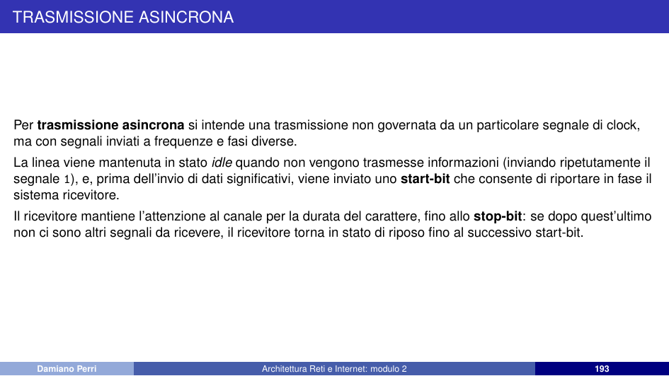
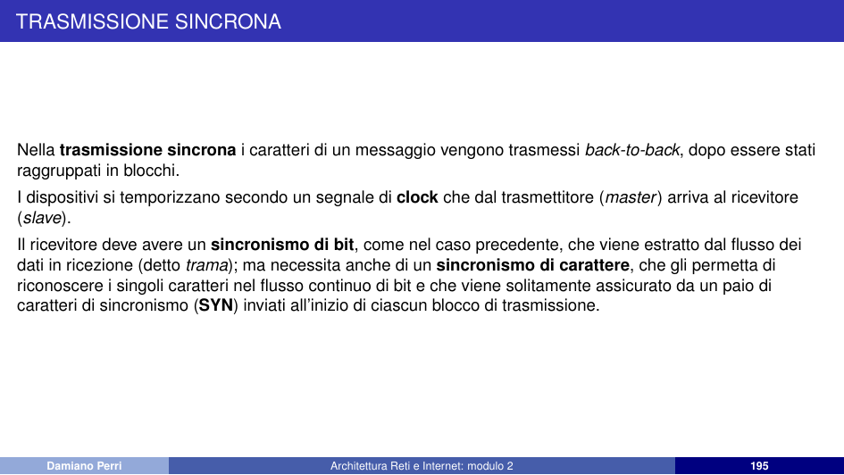
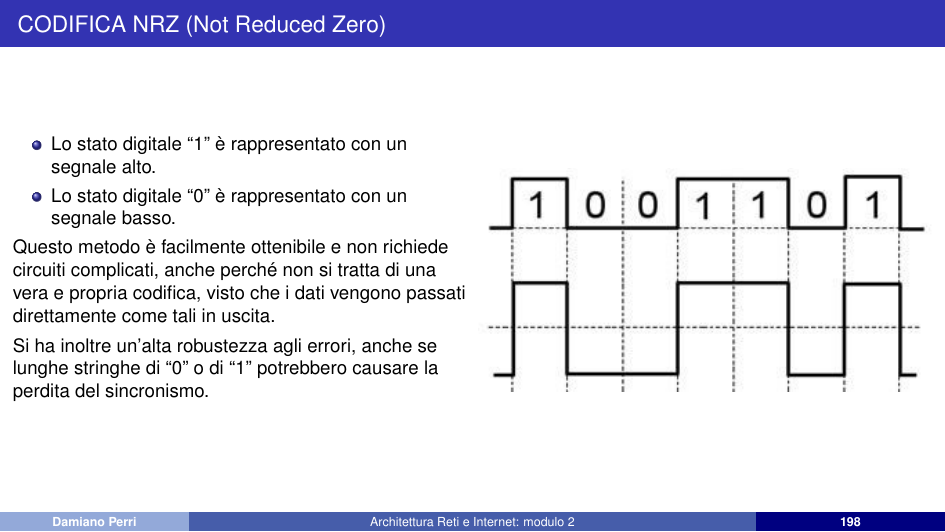
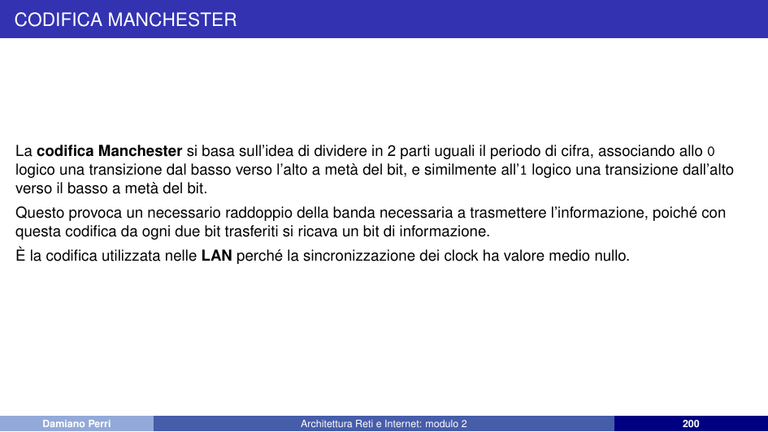
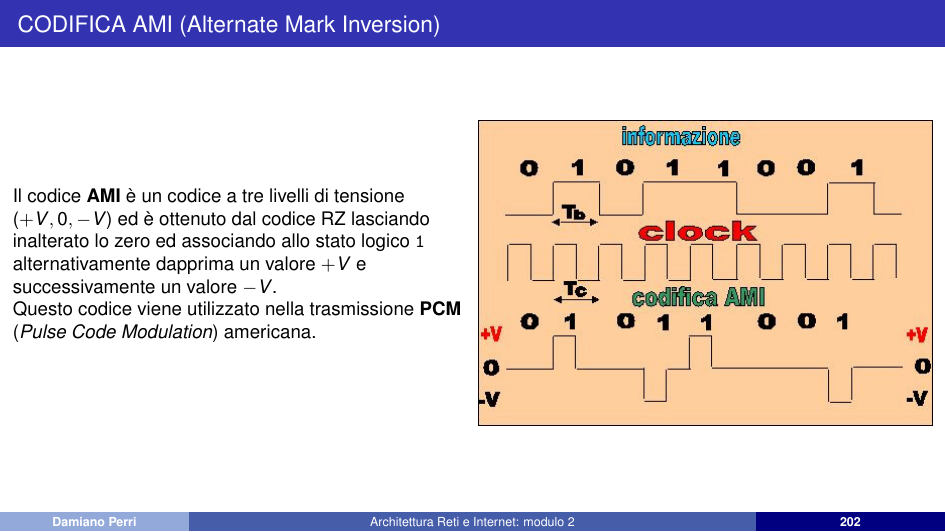
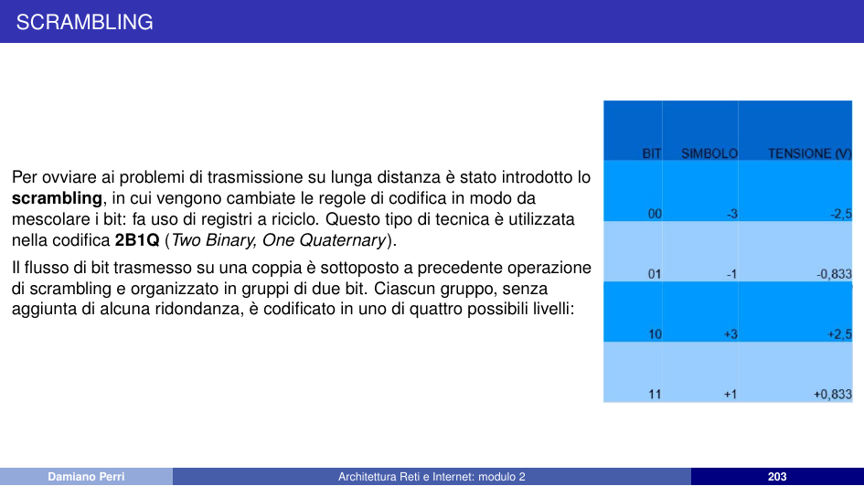
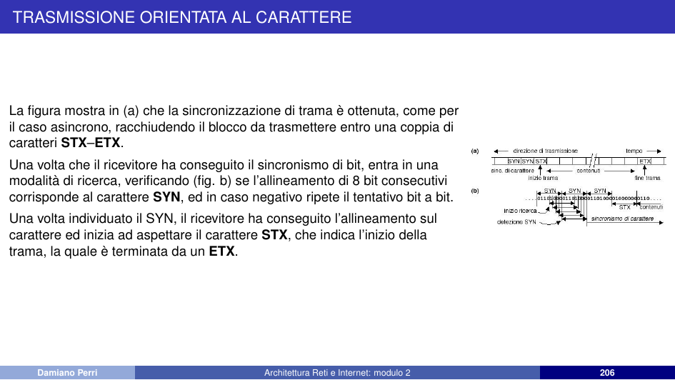
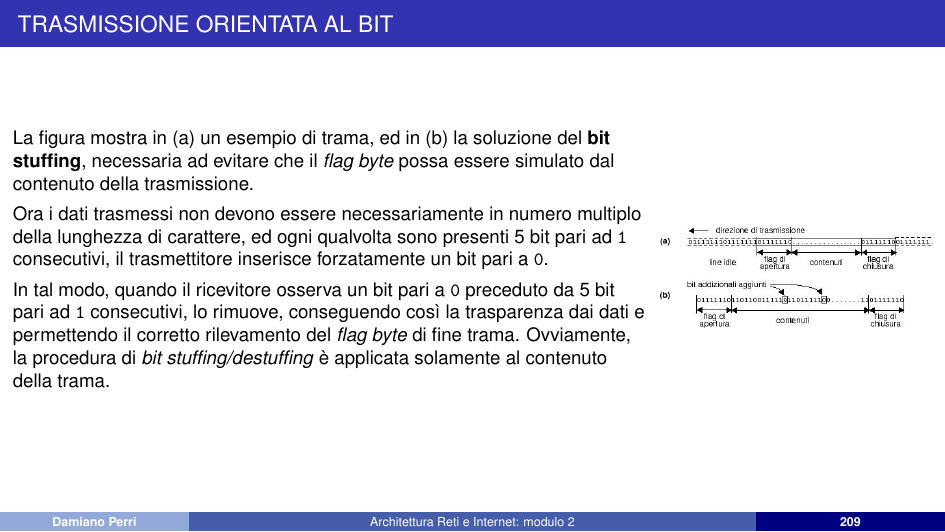
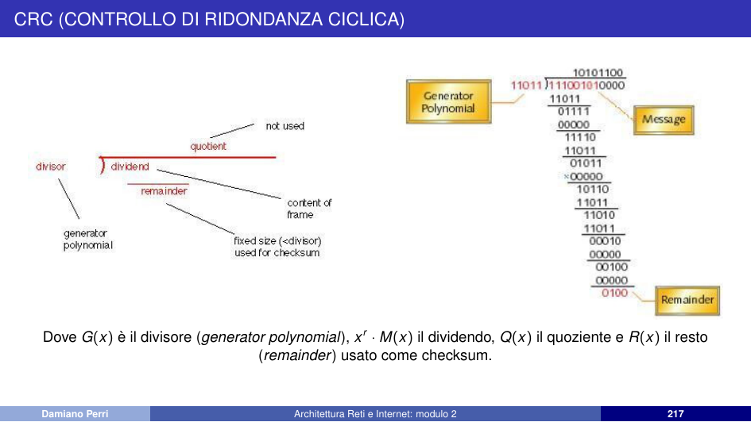

# Limiti di velocità, codifica di linea e controllo degli errori

Il teorema di Nyquist-Shannon e il multiplexing (FDM, TDM, WDM, CDM) sono già stati introdotti in [[Lezione 7-EVM, modulazioni digitali e limiti di trasmissione|Lezione 7]]. Questa lezione completa i limiti di velocità nel trasferimento e tratta la codifica di linea, i schemi di controllo trasmissione e il rilevamento degli errori.

## Limiti di velocità nel trasferimento

Si trattano altri importanti concetti nella definizione dei limiti di velocità di trasferimento: throughput, latenza e jitter.

### Throughput

Il throughput considera quanto velocemente si possono spedire dati (in bit/s) attraverso una determinata (reale) rete. La velocità trasmissiva è invece la massima velocità teorica del collegamento. Il throughput tiene conto di come l'informazione possa essere veramente smaltita, non solo inviata.

### Latenza

La latenza è il tempo necessario a un messaggio per arrivare a destinazione. Tale tempo viene considerato dall'invio del primo bit alla ricezione dell'ultimo, e si tiene conto dei seguenti fattori:

- **tempo di propagazione:** indica il tempo necessario al segnale per transitare sulla rete dal mittente al destinatario;
- **tempo di trasmissione:** misura il tempo per immettere i bit sulla rete ed è espresso dal rapporto tra la dimensione del messaggio e la velocità trasmissiva;
- **tempo di inoltro:** è il tempo necessario ai nodi della rete a consegnare il messaggio in transito; è legato a hw e sw, non al traffico;
- **tempo di attesa:** esprime il tempo di attesa nelle code di rete; è dipendente dal carico di rete.

### Jitter

Il jitter esprime la variabilità del ritardo con cui i pacchetti vengono consegnati in ricezione.

## Velocità di modulazione e velocità di trasmissione

La velocità di modulazione indica il numero di simboli trasmessi in un secondo ed è espressa in baud (simboli/sec). Il baud rate (tasso di simboli) esprime quanti simboli vengono trasmessi al secondo in un sistema di comunicazione numerico (modem).

Attenzione a non confonderla con i bps (bit per secondo), poiché in un simbolo possono essere presenti più bit.

Velocità di trasmissione e velocità di modulazione sono in relazione:

Velocità di modulazione = Velocità di trasmissione / log₂(n)

dove n indica il numero di livelli utilizzati per la modulazione e log₂(n) il numero di bit trasportati da ciascun simbolo.

Ad esempio, nella 16-QAM ad una velocità di trasmissione di 9600 bps corrisponde una velocità di modulazione di 2400 baud.

> [!info] In altre parole:
> Il baud conta i simboli al secondo, il bps conta i bit al secondo. Se ogni simbolo trasporta più bit (modulazione multilivello), il bps è maggiore del baud.

## Schemi di controllo trasmissione

I segnali digitali, per essere trasmessi tra due DTE, vanno ritrasformati in un altro segnale digitale ma con caratteristiche specifiche per un determinato tipo di trasmissione. Prima di tutto si deve definire la differenza se siamo in presenza di una trasmissione sincrona o asincrona.

### Trasmissione asincrona

Per trasmissione asincrona si intende una trasmissione non governata da un particolare segnale di clock, ma con segnali inviati a frequenze e fasi diverse.

La linea viene mantenuta in stato idle quando non vengono trasmesse informazioni (inviando ripetutamente il segnale 1), e, prima dell'invio di dati significativi, viene inviato uno start-bit che consente di riportare in fase il sistema ricevitore. Il ricevitore mantiene l'attenzione al canale per la durata del carattere, fino allo stop-bit: se dopo quest'ultimo non ci sono altri segnali da ricevere, il ricevitore torna in stato di riposo fino al successivo start-bit.

  
  
Trasmissione asincrona: start-bit, stop-bit e stato idle.

Il vantaggio di questo tipo di trasmissione è in caso di trasmissioni irregolari, ma c'è da considerare che l'aggiunta di start e stop bit incide del 30% sui bit realmente trasmessi.

### Trasmissione sincrona

Nella trasmissione sincrona i caratteri di un messaggio vengono trasmessi back-to-back, dopo essere stati raggruppati in blocchi.

I dispositivi si temporizzano secondo un segnale di clock che dal trasmettitore (master) arriva al ricevitore (slave). Il ricevitore deve avere un sincronismo di bit, come nel caso precedente, che viene estratto dal flusso dei dati in ricezione (detto trama); ma necessita anche di un sincronismo di carattere, che gli permetta di riconoscere i singoli caratteri nel flusso continuo di bit e che viene solitamente assicurato da un paio di caratteri di sincronismo (SYN) inviati all'inizio di ciascun blocco di trasmissione.

Vi sono varie alternative per la propagazione del segnale di temporizzazione: ad esempio, inviando su linee separate il segnale di clock e il messaggio (soluzione sconsigliata), oppure ricavando il clock in base al segnale ricevuto, oppure ancora ricavando il clock in base a un circuito di aggancio di fase, chiamato PLL (Phase-Locked Loop; si tratta della soluzione più usata). Una delle tecniche di sincronizzazione è il codice bipolare alternato chiamato AMI (Alternate Mark Inversion).

  
  
Trasmissione sincrona: clock master-slave e sincronismo di carattere SYN.

## Codifica di canale (encoding)

Esistono varie tecniche di codifica utilizzate per la sincronizzazione; le più comuni sono NRZ, RZ, Manchester e AMI.

### Codifica NRZ (Not Return to Zero)

Lo stato digitale "1" è rappresentato con un segnale alto. Lo stato digitale "0" è rappresentato con un segnale basso.

Questo metodo è facilmente ottenibile e non richiede circuiti complicati, anche perché non si tratta di una vera e propria codifica, visto che i dati vengono passati direttamente come tali in uscita. Si ha inoltre un'alta robustezza agli errori, anche se lunghe stringhe di "0" o di "1" potrebbero causare la perdita del sincronismo.

  
  
Codifica NRZ: livello alto per 1, livello basso per 0.

### Codifica RZ (Return to Zero)

Lo stato digitale "1" è rappresentato con un segnale alto. Lo stato digitale "0" è rappresentato con un segnale basso. A metà durata dell'impulso il segnale torna sempre a zero.

Il clock ha frequenza doppia per ridurre al 50% la durata dell'impulso. Il ricevitore deve distinguere tra 3 livelli, anziché tra 2; quindi la probabilità di errore è più grande rispetto a quella che si ha nell'NRZ. Il vantaggio è che lunghe stringhe di "0" o di "1" non causano la perdita del sincronismo.

### Codifica Manchester

La codifica Manchester si basa sull'idea di dividere in 2 parti uguali il periodo di cifra, associando allo 0 logico una transizione dal basso verso l'alto a metà del bit, e similmente all'1 logico una transizione dall'alto verso il basso a metà del bit.

Questo provoca un necessario raddoppio della banda necessaria a trasmettere l'informazione, poiché con questa codifica da ogni due bit trasferiti si ricava un bit di informazione. È la codifica utilizzata nelle LAN perché la sincronizzazione dei clock ha valore medio nullo.

Come nell'RZ, in questo metodo lunghe stringhe di "0" o "1" non causano la perdita del sincronismo. Inoltre, lavorando con solo due livelli, viene garantita un'alta robustezza agli errori. La codifica Manchester richiede un circuito più complicato rispetto a quelli per l'RZ e l'NRZ.

  
  
Codifica Manchester: transizione a metà bit per 0 e per 1.

### Codifica AMI (Alternate mark inversion)

Il codice AMI è un codice a tre livelli di tensione (+V, 0, −V) ed è ottenuto dal codice RZ lasciando inalterato lo zero ed associando allo stato logico 1 alternativamente dapprima un valore +V e successivamente un valore −V. Questo codice viene utilizzato nella trasmissione PCM (Pulse Code Modulation) americana.

  
  
Codifica AMI: tre livelli di tensione, 1 alternato +V e −V.

### Scrambling

Per ovviare ai problemi di trasmissione su lunga distanza è stato introdotto lo scrambling, in cui vengono cambiate le regole di codifica in modo da mescolare i bit: fa uso di registri a riciclo. Questo tipo di tecnica è utilizzata nella codifica 2B1Q (Two Binary, One Quaternary).

Il flusso di bit trasmesso su una coppia è sottoposto a precedente operazione di scrambling e organizzato in gruppi di due bit. Ciascun gruppo, senza aggiunta di alcuna ridondanza, è codificato in uno di quattro possibili livelli.

La codifica 2B1Q è utilizzata in ISDN (Integrated Services Digital Network) per l'accesso BASE e nelle reti HDSL (High data rate Digital Subscriber Line). Lo scrambling è utile per mantenere attiva la linea, utilizzando codici che possono mantenere il segnale costante.

  
  
Scrambling e codifica 2B1Q per ISDN e HDSL.

## Trasmissione orientata al carattere

La trasmissione orientata al carattere è usata principalmente nel caso di contenuti testuali, come per i file ASCII.

In assenza dei bit di start e di stop, la sincronizzazione di carattere è ottenuta per mezzo della trasmissione, prima dei dati veri e propri, di una sequenza di caratteri SYN (Synchronous Idle), che permettono sia di conseguire (o mantenere) il sincronismo di bit, sia di consentire l'individuazione dei confini di carattere, e quindi il sincronismo di carattere.

La figura mostra in (a) che la sincronizzazione di trama è ottenuta, come per il caso asincrono, racchiudendo il blocco da trasmettere entro una coppia di caratteri STX–ETX. Una volta che il ricevitore ha conseguito il sincronismo di bit, entra in una modalità di ricerca, verificando se l'allineamento di 8 bit consecutivi corrisponde al carattere SYN, ed in caso negativo ripete il tentativo bit a bit. Una volta individuato il SYN, il ricevitore ha conseguito l'allineamento sul carattere ed inizia ad aspettare il carattere STX, che indica l'inizio della trama, la quale è terminata da un ETX.

  
  
Sincronismo di trama con caratteri SYN, STX e ETX.

Nel caso in cui la trasmissione contenga caratteri qualunque, e dunque l'ETX possa essere simulato dai dati, si ricorre alla stessa soluzione del caso asincrono, e cioè sia l'STX che l'ETX vengono fatti precedere da un DLE (Data Link Escape – carattere di controllo), ed all'interno dei dati si esegue il byte stuffing, sostituendo gli eventuali DLE simulati con una coppia di DLE.

Per bit stuffing invece si intende: aggiungere uno 0 quando vi sono cinque 1 consecutivi. Tale tecnica è usata nella trasmissione orientata al bit.

## Trasmissione orientata al bit

Questa tecnica viene preferita sia nel caso in cui i dati da trasmettere non siano organizzati in caratteri, sia per ridurre l'inefficienza legata all'uso di caratteri di controllo aggiuntivi, nonché per evitare la dipendenza da quei particolari caratteri.

Nella trasmissione orientata al bit, la sincronizzazione di bit e di trama non impiega i caratteri SYN e STX, bensì degli idle byte 01111111 nei periodi di inattività, e dei flag byte 01111110 per indicare sia l'inizio che la fine di una trama.

La figura mostra in (a) un esempio di trama, ed in (b) la soluzione del bit stuffing, necessaria ad evitare che il flag byte possa essere simulato dal contenuto della trasmissione.

Ora i dati trasmessi non devono essere necessariamente in numero multiplo della lunghezza di carattere, ed ogni qualvolta sono presenti 5 bit pari ad 1 consecutivi, il trasmettitore inserisce forzatamente un bit pari a 0. In tal modo, quando il ricevitore osserva un bit pari a 0 preceduto da 5 bit pari ad 1 consecutivi, lo rimuove, conseguendo così la trasparenza dai dati e permettendo il corretto rilevamento del flag byte di fine trama. Ovviamente, la procedura di bit stuffing/destuffing è applicata solamente al contenuto della trama.

  
  
Trama orientata al bit e bit stuffing per trasparenza.

## Controllo degli errori

Gli errori che possono verificarsi durante la comunicazione sono di tre tipi:

- **Errori single-bit (a bit singolo):** coinvolgono un solo bit dell'unità dati (per esempio un byte) il cui valore viene trasformato da "0" a "1" o viceversa. Questo tipo di errore è il più comune.
- **Errori multiple-bit (a bit multiplo):** coinvolgono due o più bit non consecutivi dell'unità dati, il cui valore viene trasformato da "0" a "1" o viceversa. Questo tipo di errore è abbastanza comune.
- **Errori burst (a raffica):** coinvolgono due o più bit consecutivi dell'unità dati, il cui valore viene trasformato da "0" a "1" o viceversa. Questo tipo di errore è il meno comune.

## Rilevamento degli errori

Per il rilevamento degli errori si usano metodi che si basano sull'aggiunta di pochi bit scelti in modo sapiente. La tecnica che viene utilizzata da questi metodi è nota come ridondanza: i bit supplementari, infatti, sono a tutti gli effetti ridondanti e vengono distrutti non appena il sistema ricevente si sia accertato di una trasmissione corretta.

Tra gli algoritmi a controllo di ridondanza più diffusi si hanno:

- VRC (Vertical Redundancy Check – controllo di ridondanza verticale)
- LRC (Longitudinal Redundancy Check – controllo di ridondanza longitudinale)
- CRC (Cyclic Redundancy Check – controllo di ridondanza ciclica)

### VRC (controllo di ridondanza verticale)

Il VRC è il metodo più comune per il controllo d'errore: viene aggiunto un singolo bit supplementare all'unità dati in modo che il numero di bit uguali a "1" dell'intera unità, bit supplementare compreso, diventi pari o dispari. Nel primo caso si parla di parity check o controllo di parità, nel secondo caso si parla di controllo di disparità.

L'algoritmo VRC è molto facile da implementare ma ha diversi limiti: se infatti un'unità ha un numero pari di bit invertiti, si ha una compensazione dell'errore, che quindi non viene rilevato.

### LRC (controllo di ridondanza longitudinale)

L'algoritmo LRC è una sorta di VRC bidimensionale. Come nel VRC si ha infatti l'aggiunta del bit di parità ad ogni unità dati. Ad ogni blocco viene però aggiunta un'unità supplementare che contiene i bit di parità associati alle sequenze di bit corrispondenti del blocco.

L'algoritmo LRC assicura maggiore affidabilità nell'individuazione degli errori di tipo multiple-bit e burst, ma ha ancora dei limiti poiché può essere tratto in inganno da trasposizioni di byte.

### CRC (controllo di ridondanza ciclica)

Il CRC è orientato ai bit, associando ogni sequenza di k bit ai coefficienti di un polinomio di grado k − 1 (es. 1100110 = x⁶ + x⁵ + x² + x). Viene associato ad ogni sequenza un checksum tale che il polinomio generato sia divisibile per G(x), polinomio generatore noto a priori a mittente e ricevitore.

Il checksum è calcolabile come segue:

1. si aggiungono r bit 0 al segmento, ottenendo m + r bit, corrispondenti al polinomio xʳ · M(x), ove r è il grado di G(x) e M(x) è il polinomio della sequenza iniziale;
2. si divide xʳ · M(x) per G(x) in aritmetica mod 2 (xʳ M(x) = G(x) · Q(x) + R(x)): il resto R(x) è il polinomio corrispondente alla sequenza di checksum;
3. si somma R(x) a xʳ · M(x) ottenendo il segmento da trasmettere completo di checksum.

Dove G(x) è il divisore (generator polynomial), xʳ · M(x) il dividendo, Q(x) il quoziente e R(x) il resto (remainder) usato come checksum.

  
  
CRC: dividendo, divisore, quoziente e resto (checksum).

Non tutti i polinomi di tipo G(x) sono adatti allo scopo, poiché in alcuni casi si può ottenere lo stesso checksum anche da sequenze di invio sbagliate. Di fatto, se si inviasse una sequenza errata che, dopo l'esecuzione dell'algoritmo, risultasse comunque verificata, si potrebbe incorrere in gravi incongruenze.

Da ciò, alcuni suggerimenti per la scelta di G(x):

- Con polinomi dove il termine noto x⁰ = 1, gli errori pari ad un bit sono sempre rilevati.
- Polinomi con (x + 1) come fattore permettono la rilevazione di tutti gli errori di numero dispari.
- Scegliere il grado r più grande possibile. Ad esempio HDLC usa r = 16.

Nel caso di errori burst, ponendo che l'errore inizi al punto i e finisca al punto j, possiamo esprimere il vettore errore come e(x) = xⁱ + … + xʲ. L'ampiezza della raffica di errori è data da L = (i − j + 1) bit.

Si potranno quindi avere 3 casi (dove r è il numero dei bit aggiuntivi):

- con L ≤ r: verranno rilevati tutti gli errori nella raffica;
- con L = r + 1: l'errore non viene rilevato con probabilità pari a 1/2⁽ʳ⁻¹⁾;
- con L > r + 1: l'errore non viene rilevato con probabilità pari a 1/2ʳ.

> [!info] Sintesi:
> - Throughput è la velocità reale di smaltimento dati; latenza è il tempo dall'invio del primo bit alla ricezione dell'ultimo (propagazione + trasmissione + inoltro + attesa); jitter è la variabilità del ritardo di consegna.
> - Il baud conta i simboli al secondo, il bps i bit al secondo; un simbolo può contenere più bit.
> - Trasmissione asincrona: start/stop bit, vantaggiosa per traffico irregolare ma con ~30% di overhead. Trasmissione sincrona: blocchi back-to-back con clock master-slave e sincronismo di carattere SYN.
> - Codifiche di linea: NRZ (semplice, perde sincronismo su lunghe stringhe), RZ (ritorno a zero, 3 livelli), Manchester (transizione a metà bit, raddoppio della banda, usata in LAN), AMI (3 livelli, 1 alternato, PCM americana), scrambling 2B1Q (ISDN, HDSL).
> - Trasmissione orientata al carattere: sequenze SYN, incorniciatura STX–ETX, DLE e byte stuffing. Orientata al bit: idle byte 01111111, flag byte 01111110, bit stuffing dopo cinque 1 consecutivi.
> - Errori: single-bit (più comune), multiple-bit, burst (meno comune).
> - Rilevamento: VRC (parità, semplice ma non rileva errori pari), LRC (bidimensionale, migliore ma ingannato da trasposizioni), CRC (orientato ai bit, polinomio generatore G(x), checksum come resto della divisione mod 2).
> - Per errori burst di ampiezza L e r bit di ridondanza: L ≤ r sempre rilevati; L = r + 1 con probabilità 1/2⁽ʳ⁻¹⁾ di non rilevamento; L > r + 1 con probabilità 1/2ʳ di non rilevamento.
