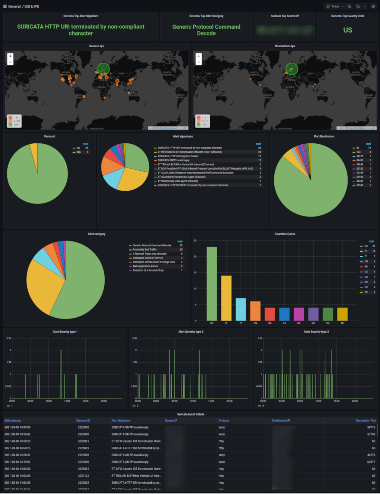

# IDS e IDPS

<div style="display: flex; justify-content: center;">
  
</div>

<div style="display: flex; justify-content: center;">
  
</div>


## IDS — Intrusion Detection System
Un **IDS** (*Intrusion Detection System*) è un sistema che identifica e analizza tempestivamente i potenziali incidenti di sicurezza.

Le funzionalità e le attività chiave svolte dal sistema sono:

- **Analisi incidenti:** identificare e analizzare tempestivamente i potenziali incidenti di sicurezza.
- **Logging:** loggare informazioni dettagliate sugli eventi, fondamentali per analisi future.
- **Notifiche real-time:** notificare in tempo reale i sysadmin di eventi critici (email sospette, connessioni anomale).
- **Reportistica:** produrre report periodici e documentazione sullo stato delle minacce.

## IPS — Intrusion Prevention System
Un **IPS** (*Intrusion Prevention System*) garantisce prevenzione attiva e blocco delle minacce in tempo reale.

*Definizione:* di base funziona come un IDS, ma ha in più la capacità di prevenire gli attacchi fermandoli in tempo reale.

- **Intervento sul contenuto:** agisce direttamente sui pacchetti e sul traffico inviato dall'attaccante.
  *Esempio pratico:* se rileva una richiesta HTTP non autorizzata ad un endpoint protetto, l'IPS agisce da proxy modificando la richiesta e reindirizzandola per neutralizzarla.
- **Modifica del security environment:** arresta gli attacchi riconfigurando la struttura di sicurezza circostante.
  *Esempio pratico:* cambia le regole del firewall per isolare tempestivamente host potenzialmente compromessi.

## IDPS — utilizzi aggiuntivi
Possono essere utili anche per altre ragioni e contesti operativi:

- **Security policy problems:** identifica problemi di policy. Es. rileva traffico di rete che sarebbe dovuto essere bloccato dal firewall ma non viene bloccato.
- **Indagini sui threat:** consente di usare i log raccolti per fare indagini approfondite sulle minacce e sui vettori di attacco più frequenti.
- **Deterrenza attacchi:** un attaccante consapevole della presenza di un IDPS potrebbe essere scoraggiato e orientato verso target più semplici (*low hanging fruit*).

## Precisione e tuning
Bilanciamento tra falsi positivi e falsi negativi nella configurazione IDPS.

*Obiettivo del tuning:* gli IDPS non sono precisi al 100%. Un tuning personalizzato adatta la configurazione all'uso specifico per minimizzare gli errori totali.

| | Configurazioni conservative | Configurazioni permissive |
|---|---|---|
| Obiettivo | Massimizzano la protezione per evitare che minacce reali passino inosservate | Privilegiano la fluidità operativa riducendo le interruzioni imprevisti |
| Impatto | Riduzione falsi negativi; aumento falsi positivi | Riduzione falsi positivi; aumento falsi negativi |

> [!warning] Falsi positivi e falsi negativi
> - **Falso positivo:** un evento legittimo segnalato come minaccia.
> - **Falso negativo:** una minaccia reale non rilevata.
> Se abbassiamo la soglia di rilevamento, possono aumentare i falsi positivi. Un falso positivo in modalità IPS può portare al blocco di traffico legittimo.
## Raccomandazioni IDPS
Linee guida per la protezione dei sistemi di rilevamento e la scelta delle architetture:

- **Protezione degli IDPS stessi:** garantire la sicurezza e l'integrità degli strumenti di difesa prioritariamente. Gli IDPS sono spesso target di attaccanti che intendono disabilitarli. Mantenere sempre aggiornati sensori, agenti, server centrali e database.
- **Diversificazione delle tipologie:** adottare un approccio multilivello per una copertura completa ed esaustiva. Combinazione ideale: integrare principalmente network-based e host-based per la massima efficacia.

## Tipologie di IDPS
- **Signature-based**
- **Anomaly-based**
- **Stateful protocol analysis**

### Signature-based
Rilevamento dei malware basato sul confronto con minacce già note.

*Funzionamento:* identificazione tramite pattern specifici. Riconosce minacce già conosciute. Lookup IDPS: ricerca corrispondenze nel database ad ogni evento. Antivirus: scansione di stringhe o istruzioni univoche del malware.

*Esempio pratico:* email sospetta. L'IDPS intercetta un allegato malevolo (file target `LOVE-LETTER-FOR-YOU.TXT.vbs`). Azione immediata: associazione alla campagna malware e generazione alert/blocco.

*Database & condivisione delle informazioni:* formato standard (le signature sono strutturate in formati standardizzati); open source (vasta disponibilità di database pubblici e comunitari per l'aggiornamento).

> [!warning] Limiti delle signature
> Una signature controlla soltanto il nome `LOVE-LETTER-FOR-YOU.TXT.vbs`. Se rinominiamo il file, la rilevazione fallisce, ma la pericolosità del file resta. Una signature più robusta potrebbe controllare il contenuto o l'hash del file piuttosto che il solo nome.

### Anomaly-based detection
Rilevamento delle minacce basato sulle deviazioni dal comportamento normale.

*Principio base:* analisi del traffico e deviazioni rispetto al classico utilizzo del prodotto difeso.

*Caratteristiche:*
- **Fase di training / creazione dei profili di baseline:** profilazione. Baseline normale: stabilisce il comportamento standard della rete. Entità modellate: crea profili per singoli user, host, traffico di rete e applicazioni.
- **Rilevamento IDPS:** identifica anomalie rispetto al classico utilizzo del prodotto difeso. Focus: monitoraggio continuo del comportamento di rete.
- **Notifiche attive:** generazione automatica di alert. Caso pratico: media osservata 10 login falliti al giorno (comportamento normale); anomalia: se si registrano 100 login falliti in un giorno, viene generato un alert.

> [!info] Pro e contro: Anomaly-Based
> *Vantaggi:* rilevamento e flessibilità; threat nuovi (in grado di rilevare anche minacce sconosciute o zero-day); profili adattivi (profili statici o dinamici per seguire l'evoluzione della rete).
> *Rischi:* creazione profili; criticità nella baseline.
> *Limiti:* traffico illecito (rischio di includere attività malevole già presenti nella baseline); stima inaccurata (eventi rari, es. manutenzioni mensili, rischiano di non essere integrati); falsi allarmi (alto rischio di falsi positivi per deviazioni legittime dalla norma); opacità alert (difficile valutare l'effettiva causa e fondatezza degli alert generati).

### Stateful Protocol Analysis
Analisi dello stato delle connessioni e rilevamento delle violazioni di protocollo.

*Definizione e stato:* comparazione del traffico. Processo: confronto tra profili ben definiti di traffico legittimo e traffico registrato. Capacità IDPS: tracciamento e comprensione dello stato delle connessioni per le valutazioni.

*3-Way handshake:* verifica sequenza di connessione. Flusso TCP: sequenza standard (flusso regolare composto da SYN, SYN-ACK, ACK). Violazione: ricezione diretta di ACK senza SYN iniziale.

*Stato FTP:* autenticazione, controllo ordine comandi. Sequenza comandi: prerequisito autenticazione utente con USER e PASS. Violazione: esecuzione di GET prima di essersi autenticati.

> [!info] Pro e contro: Stateful Protocol Analysis
> *Vantaggi:* rilevamento e ispezione; attacchi nuovi (rileva minacce sconosciute segnalando sequenze fuori standard); check singoli (verifica comandi individuali, es. lunghezza massima argomenti).
> *Standardizzazione:* modelli & standard; RFC e vendor (profili basati su standard ufficiali ed implementazioni note); discrepanze (pratiche reali diverse dallo standard possono generare imprecisioni).
> *Limiti:* criticità & limiti; prestazioni e punti ciechi (carico CPU molto pesante computazionalmente per la complessità dell'analisi); attacchi leciti (non rileva minacce che rispettano il protocollo, es. DDoS).
## Componenti di un IDPS
Architettura dei moduli principali e rete di gestione dedicata:

- **Sensore / Agente:** inserito nell'ambiente da controllare (rete, host) per raccogliere informazioni e compiere azioni (IDS).
- **Management Server:** modulo centralizzato che riceve i dati dai sensori, esegue analisi e genera report/notifiche.
- **Database Server:** archivio centrale che mantiene lo storico di tutti gli eventi raccolti dagli agenti e dal server.
- **Console:** interfaccia di comando per configurare l'IDPS, scaricare aggiornamenti e gestire i sensori.

### Rete di comunicazione e isolamento dell'architettura
- **Management network:** la comunicazione tra componenti avviene su una rete dedicata tramite la management interface.
- **Isolamento di sicurezza:** i sensori non possono far passare traffico verso altre reti, isolando e proteggendo completamente l'IDPS dalla rete principale.

## Detection Tuning
Configurazione ed ottimizzazione dei parametri di rilevamento dell'IDS:

- **Threshold Tuning:** definizione dei limiti tra comportamento normale e anomalo (es. tentativi max di login).
- **Filtri:** blacklist & whitelist. Gestione host autorizzati/bloccati, regole ICMP/URL e blacklist dinamiche in real-time.
- **Notifiche:** alert settings. Personalizzazione della priorità degli alert, gestione delle disabilitazioni e filtri.
- **Ispezione codice:** accesso diretto al codice di rilevamento dell'IDPS per analizzare e modificare la logica di identificazione degli alert a piacimento.
- **Reazione automatica:** risposte & prevenzione (IPS). Customizzazione delle azioni automatiche di prevenzione e risposta attiva per ciascuna specifica tipologia di minaccia rilevata.

## Tipi di IDS
Classificazione dei sistemi di rilevamento delle intrusioni:

- **Network Based:** monitorano il traffico su specifici segmenti di rete. Vengono posizionati di norma ai confini di rete, come tra firewall e router.
- **Wireless:** analizzano il traffico wireless per intercettare minacce sui relativi protocolli. Non rilevano attività sospette nei livelli superiori (TCP/UDP).
- **NBA (Network Behavior Analysis):** esaminano il tipico flusso di rete per identificare anomalie e generare report dettagliati in caso di traffico inusuale.
- **Host Based:** monitorano le caratteristiche di un singolo host, analizzando i log del SO (creazione file, esecuzione programmi, ecc.) e agendo di conseguenza.
## Network Based IDPS
### Componenti tipiche
Architettura dei sensori per Network-Based IDPS.

*Funzionamento dei sensori di rete:* simili agli altri IDPS tranne che per i sensori, i quali monitorano e analizzano l'attività di rete su uno o più segmenti. L'interfaccia di rete deve essere impostata in modalità promiscua (accetta tutti i pacchetti intercettati, indipendentemente dalla destinazione).

- **Appliance:** un appliance-based sensor è un hardware specifico ottimizzato per l'utilizzo dedicato come sensore di rete. Viene fornito e configurato frequentemente con un hardened OS per massimizzare sicurezza e prestazioni.
- **Software Only:** soluzione flessibile costituita semplicemente da un applicativo software installabile ed eseguibile su un host generico o server già presente nell'infrastruttura.

### Network architecture e sensor location
Configurazione dell'infrastruttura di rete e strategie di posizionamento IDPS.

*Protezione delle comunicazioni IDPS:* se possibile le organizzazioni dovrebbero usare delle management networks; se non è possibile, una VLAN dovrebbe essere usata per proteggere le comunicazioni dell'IDPS.

- **Inline:** i sensori vengono inseriti direttamente lungo il percorso del traffico di rete. Permettono di monitorare e intervenire attivamente sulle connessioni in transito.
- **Passive:** i sensori analizzano una copia del traffico di rete (tramite port mirroring o TAP), effettuando il monitoraggio senza alterare il flusso dei dati.

### Sensori inline
Funzionamento, vantaggi e strategie di posizionamento nella rete.

*Funzionamento ed architettura:* un sensore inline è posizionato direttamente sul percorso del traffico: tutti i dati monitorati passano al suo interno. Funziona in modo analogo a un firewall, ed infatti alcuni sensori inline integrano funzionalità ibride firewall/IDPS.

*Vantaggio chiave:* prevenzione attiva. Il principale vantaggio dei sensori inline è la capacità di stoppare attacchi in corso in tempo reale, bloccando direttamente il traffico di rete malevolo.

*Strategia di deployment:* se integrano funzioni firewall si collocano ai confini tra varie reti. In alternativa, si inseriscono in segmenti interni più protetti per ridurre il volume di traffico da processare.

### Sensori passivi
Architettura di monitoraggio fuori banda e acquisizione del traffico.

*Principio di funzionamento:* il sensore è schierato per analizzare una copia del traffico reale. Nessun traffico diretto attraversa il dispositivo, che viene posizionato per monitorare punti chiave della rete come i confini inter-rete.

- **Spanning port:** molti switch offrono una porta in grado di duplicare e leggere tutto il traffico in transito. Configurazione semplice ed economica; monitoraggio centralizzato su switch; dipendenza dalle prestazioni dello switch.
- **Network Tap:** connessione diretta tra il sensore e il supporto fisico di rete (es. cavo in fibra ottica). Accoppiamento hardware diretto; copia completa e fedele dei pacchetti; nessun impatto sulle prestazioni dello switch.
- **IDS Load Balancer:** dispositivo dedicato che aggrega e smista il traffico di rete verso molteplici sistemi IDPS. Bilanciamento dinamico dei flussi; scalabilità per reti ad alto traffico; distribuzione basata su regole.

### Domande: dove passa il traffico?
Suricata riceve una copia del traffico da una porta mirror dello switch.

1. Può scartare direttamente il pacchetto originale? Come cambiereste il posizionamento per farlo?
2. Se il sensore si spegne, la rete continua a funzionare? La risposta cambia con un sensore inline?

## Suricata
Motore open source per l'analisi del traffico di rete.

*Obiettivo del laboratorio:* nel laboratorio useremo Suricata come IDS e scriveremo regole personalizzate.

- **Modalità IDS — Detection & Alert:** in modalità IDS osserva il traffico e genera alert quando riconosce condizioni definite nelle regole.
- **Modalità IPS — Prevenzione In-Line:** in modalità IPS può bloccare il traffico, se configurato nel percorso di inoltro dei pacchetti.
- **Analisi offline:** esame file PCAP. Può anche analizzare file PCAP per esaminare traffico registrato in precedenza.

### Funzionamento
Flusso di elaborazione e rilevamento del traffico in Suricata:

1. **Acquisizione:** cattura pacchetti. Il sensore acquisisce i pacchetti dall'interfaccia monitorata.
2. **Decodifica:** stato connessioni. Suricata decodifica i protocolli e mantiene informazioni sullo stato delle connessioni.
3. **Ricostruzione:** flussi TCP. Ricostruisce i flussi TCP e interpreta i protocolli applicativi supportati.
4. **Detection:** analisi. Il motore di detection confronta il traffico con le regole caricate.
5. **Logging:** alert & eventi. Quando una regola con azione `alert` corrisponde, registra un evento nei log.

*Caratteristiche delle regole:* una regola può combinare contenuto, direzione e stato della connessione.

### Struttura di una regola
Sintassi ed elementi costitutivi delle regole di rilevamento Suricata.

```text
alert http any any -> $HOME_NET any (msg:"LAB URI contenente /admin"; flow:established,to_server;
http.uri; content:"/admin"; sid:1000001; rev:1;)
```

Sintassi generale: azione protocollo IP_sorgente porta_sorgente direzione IP_destinazione porta_destinazione (opzioni;)

- **Header base (azione e protocollo):** `alert`: azione da eseguire quando la regola corrisponde. `http`: protocollo applicativo da analizzare.
- **Traffico e indirizzi:** `any any -> $HOME_NET any`: specifica gli indirizzi IP (sorgente/destinazione), le porte e la direzione del flusso di rete.
- **Opzioni e revisione:** `msg`: messaggio di notifica associato all'alert. `sid`: identificatore univoco della regola. `rev`: numero di revisione della regola.

> [!info] Distinzione chiave
> La parte prima delle parentesi costituisce l'header (intestazione del traffico). Tra parentesi racchiudiamo le opzioni per l'analisi del contenuto e la gestione delle segnalazioni.

### Analisi del contenuto HTTP
Opzioni di ispezione dei campi e corrispondenza del payload nelle regole Suricata:

- `flow:established`: seleziona traffico appartenente a connessioni stabilite.
- `to_server`: limita l'ispezione al traffico diretto al server.
- `http.uri`: seleziona l'URI normalizzato della richiesta HTTP da analizzare.
- `content:"/admin"`: cerca questa specifica sequenza all'interno del campo selezionato.
- `http.method`: permette di verificare il metodo della richiesta (es. GET o POST).
- `http.user_agent`: permette di controllare l'intestazione User-Agent del client.

> [!info] Comportamento del pattern matching
> La regola precedente riconosce anche `/administrator`: il pattern viene matchato come sottostringa.

### Configurazione Suricata
Parametri di rete, gestione dei ruleset e comandi di verifica dell'istanza:

- **Interfaccia:** acquisizione. L'interfaccia di acquisizione determina quale traffico può osservare il sensore.
- **Rete:** HOME_NET. HOME_NET identifica gli indirizzi della rete che vogliamo proteggere.
- **Ruleset:** origine regole. Le regole possono provenire da ruleset pubblici oppure da file personalizzati. `suricata-update`: scarica e aggiorna automaticamente i ruleset configurati.
- **Verifica:** `suricata -T`. Prima dell'avvio, permette di verificare configurazione e caricamento delle regole.

> [!info] Contesto di laboratorio
> Nel laboratorio caricheremo esclusivamente le nostre regole con l'opzione `-S`.

### Lettura di alert
- `fast.log` contiene una sintesi testuale degli alert, quando l'output è abilitato.
- `eve.json` contiene eventi JSON, inclusi alert e metadati dei protocolli abilitati.
- Un alert permette di identificare timestamp, sorgente, destinazione e regola corrispondente.
- Il campo `flow_id` aiuta a correlare eventi riferiti allo stesso flusso.
- `jq` permette di filtrare i log e selezionare i campi utili all'analisi.

> [!info] Un alert sulla richiesta a `/admin` non dimostra che l'accesso sia riuscito.

### Tuning
- Una regola troppo generica può segnalare attività legittime.
- Una regola troppo restrittiva può perdere eventi che vorremmo rilevare.
- Il tuning richiede test positivi e negativi rispetto alla policy da applicare.
- Il sensore deve ricevere il traffico rilevante per poterlo analizzare.
- Con HTTPS, un sensore senza accesso al traffico decifrato non può cercare liberamente URI e contenuti HTTP.

> [!info] La qualità della detection dipende dalla regola, dalla visibilità e dal contesto.

### Laboratorio
- Due VM comunicano su una rete interna VirtualBox.
- Il client, `192.168.50.10`, genera richieste con `curl`.
- Il server, `192.168.50.20`, ospita un servizio HTTP sulla porta `8000`.
- Suricata viene eseguito sul server e osserva l'interfaccia della rete interna.
- Le regole generano alert che analizzeremo in `eve.json`.

Obiettivo: rilevare richieste definite dalla policy e verificare il significato degli alert.

### Setup
1. Verificare la connettività tra le VM.
2. Avviare il server HTTP e Suricata con la regola fornita.
3. Richiedere `/` e `/admin` dal client.
4. Individuare l'alert e identificare sorgente, destinazione e SID.
5. Spiegare perché l'alert può comparire anche quando il server risponde `404`.

Consegna: la regola utilizzata e un alert commentato.

### Challs
**Challenge 1 — Precisione:** segnalare esclusivamente l'URI `/admin`, escludendo `/administrator` e `/manuale/admin-guide.html`.

**Challenge 2 — Metodo HTTP:** segnalare le richieste `POST` all'URI esatto `/upload`, escludendo le richieste `GET`.

**Bonus — Frequenza degli eventi:** generare un alert al quinto accesso a `/admin` dallo stesso IP entro 30 secondi. Per ogni regola: fornire un test positivo, almeno due test negativi e una breve spiegazione.

### Installazione
```sh
sudo apt update
sudo apt install -y software-properties-common
sudo add-apt-repository -y ppa:oisf/suricata-stable
sudo apt update
sudo apt install -y suricata suricata-update jq python3 curl tcpdump nano
suricata -V
sudo suricata --build-info
sudo systemctl stop suricata
```

